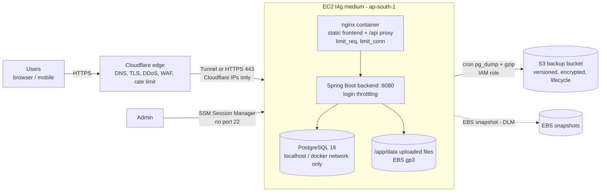
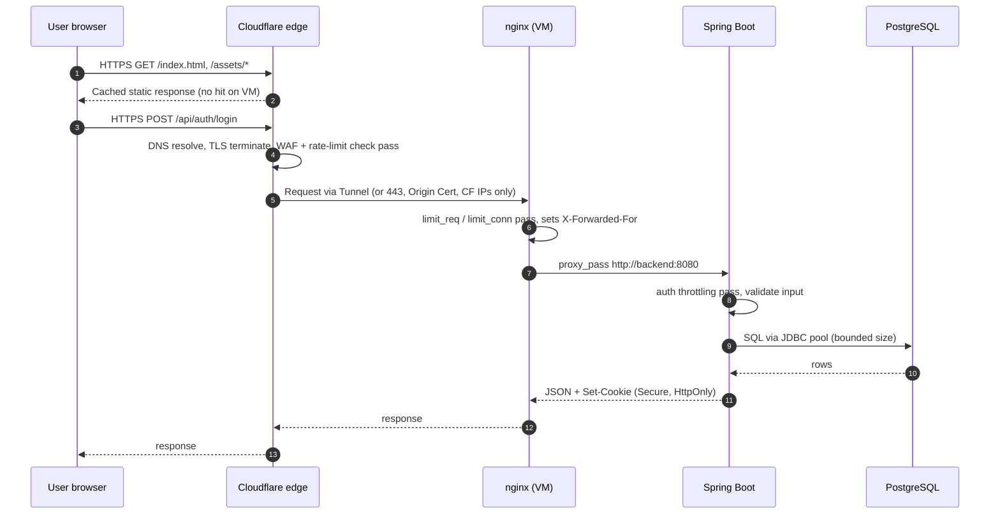
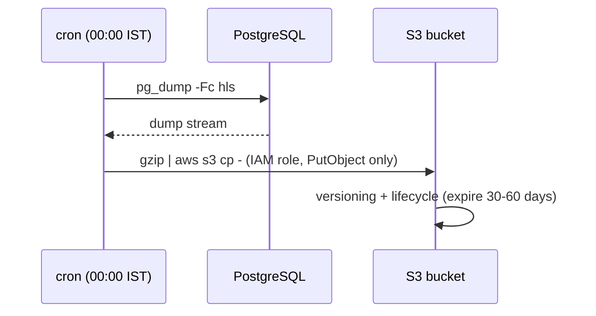
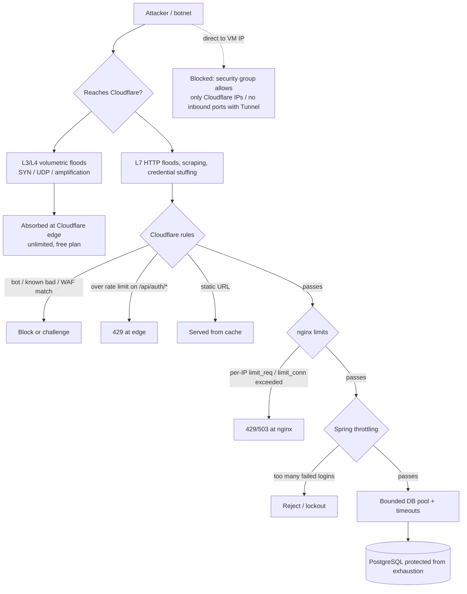

# AWS Deployment (India) and DDoS Protection — Single-VM Setup

Status: proposal · Region: `ap-south-1` (Mumbai) · Scope: one EC2 VM running nginx + Spring Boot backend + PostgreSQL, Cloudflare in front, weekly/daily backups to S3.

> Prices are approximate on-demand figures from memory (USD, Mumbai). Confirm in the AWS Pricing Calculator before committing. AWS India adds 18% GST. Exchange rate used: ~₹88/USD.

---

## 1. Target architecture



Key points:

- Only Cloudflare can reach the VM. The VM's own IP is never published.
- Postgres is never exposed outside the VM.
- Admin access uses SSM Session Manager (free), not SSH.
- No ALB, no NAT gateway, no RDS (cost control).

The repo already has `docker-compose.local.yml` and `docker/nginx.local.conf` with the same shape (nginx serves the SPA and proxies `/api/` to `backend:8080`). Production reuses that layout with TLS and hardening added.

---

## 2. Monthly cost

| Item | Choice | $/month |
|---|---|---|
| EC2 | t4g.medium (2 vCPU, 4 GB, ARM) — or t3.medium ~$33 if images are x86 only | ~27 |
| EBS | 30 GB gp3 | ~3 |
| Public IPv4 | 1 address (billed hourly) | ~3.7 |
| EBS snapshots (DLM, daily, 7 retained) | incremental | ~1 |
| S3 backups | ~20 GB, lifecycle expire 30–60 days | ~0.5 |
| Data transfer out | first 100 GB/month free (Cloudflare caches static assets) | 0–2 |
| Cloudflare | Free plan | 0 |
| Route 53 | not needed (Cloudflare DNS) | 0 |
| SSM Session Manager | free | 0 |
| **Total** | | **~$35–38 (≈ ₹3,100–3,350), ≈ ₹3,700–4,000 with GST** |

One-time / yearly: domain ~$10–15/yr (`.com`) or ~₹700–900/yr (`.in`).

Savings and upgrades:

- 1-year Compute Savings Plan or reserved instance: about 30–35% off EC2 (total ~$28–32).
- Cloudflare Pro: +$20–25/month for the full managed WAF ruleset and more rate-limit rules.
- t4g.small/t3.small (~$12–17) is possible for a demo only; Spring Boot + Postgres in 2 GB risks OOM.
- New AWS accounts get 12 months of free tier (750 h/month of t3.micro/t4g.small), which can make a pilot nearly free in year one.

Not recommended at this size: ALB (~$18+), RDS (~$15–20+), NAT gateway (~$35+), Shield Advanced ($3,000/month).

---

## 3. Data flow — normal traffic



What each layer does in normal flow:

| Layer | Role |
|---|---|
| Cloudflare | Resolves DNS, terminates public TLS, caches static assets, runs WAF/rate-limit/bot checks, forwards allowed requests |
| nginx | Serves SPA files, proxies `/api/` to backend, per-IP request and connection limits, size/timeout limits |
| Spring Boot | Authentication, authorization, business logic, login/OTP throttling |
| PostgreSQL | Data store; reachable only from the backend |
| S3 | Receives scheduled dumps only (outbound from VM, never serves users) |

Backup flow (separate, scheduled):



---

## 4. Data flow — under attack



Attack scenarios and where each is stopped:

| Attack | Stopped at | Mechanism |
|---|---|---|
| SYN/UDP/volumetric flood | Cloudflare | Anycast absorption; also AWS Shield Standard on the VM IP as a backstop |
| HTTP flood on static pages | Cloudflare | Edge cache; the VM never sees it |
| HTTP flood on `/api/*` | Cloudflare → nginx | Edge rate limit, then `limit_req`; "Under Attack" mode if needed |
| Credential stuffing / OTP abuse | Cloudflare → Spring | Rate-limit rule on auth endpoints, Bot Fight Mode, app lockout |
| Slowloris / slow POST | nginx | Short client timeouts, `limit_conn` |
| Origin IP discovered and attacked directly | Security group / Tunnel | Port 443 only open to Cloudflare ranges (or no inbound ports) |
| SQL injection / common exploits | Cloudflare WAF → app | Managed ruleset, parameterized queries |
| Expensive queries (reports, search) | Spring / DB | Rate limit, caching ([caching.md](caching.md)), pool and statement timeouts |
| SSH brute force | AWS | Port 22 closed; SSM only |

Residual risk: a single VM cannot survive a sustained attack that gets through as valid-looking requests. Mitigate with caching, tight rate limits, and moving to Cloudflare Pro or a second instance if the service becomes critical.

---

## 5. Implementation guide

### 5.1 AWS foundation

1. Create an AWS account (AWS India), enable MFA on root, create an admin IAM user/role, set a **budget alert** at ~$50.
2. Region: `ap-south-1`.
3. VPC: default VPC is fine. One public subnet.
4. Launch EC2:
   - AMI: Amazon Linux 2023 (arm64 for t4g).
   - Type: t4g.medium. Storage: 30 GB gp3, encrypted.
   - IAM instance profile with: `AmazonSSMManagedInstanceCore` and a custom policy (5.6).
   - IMDSv2 required.
5. Allocate and attach an Elastic IP.
6. Security group `hls-web`:
   - **With Tunnel (recommended):** no inbound rules at all.
   - **Without Tunnel:** inbound TCP 443 only from Cloudflare ranges (https://www.cloudflare.com/ips-v4 and `ips-v6`). No 80, no 22, no 5432.
   - Outbound: allow all (needed for package updates, S3, Tunnel).
7. Install Docker and the compose plugin; add swap (2 GB) as a safety net.

### 5.2 Domain and Cloudflare

1. Buy the domain; add it to Cloudflare (Free); change nameservers at the registrar.
2. DNS: `A app.example.com → <Elastic IP>`, **proxied (orange cloud)**. With Tunnel, create a CNAME to the tunnel instead.
3. SSL/TLS: mode **Full (strict)**; enable **Always Use HTTPS**, **Automatic HTTPS Rewrites**, minimum TLS 1.2.
4. SSL/TLS → Origin Server: create an **Origin Certificate** (15 years), save as `origin.pem` and `origin.key` on the VM (not in git).
5. Origin lock-down (choose one):
   - **Cloudflare Tunnel:** Zero Trust → Networks → Tunnels → create; run `cloudflared` as a container on the compose network pointing to `http://frontend:80`. No inbound ports.
   - **IP allowlist + Authenticated Origin Pulls:** security group as in 5.1, enable Authenticated Origin Pulls, and configure nginx `ssl_client_certificate` with Cloudflare's origin-pull CA.
6. Security settings:
   - Security → Settings: Security Level **Medium**; **Bot Fight Mode** on.
   - Security → WAF → Managed rules: enable the free managed ruleset.
   - Security → WAF → Rate limiting rules (free plan allows 1 rule; Pro allows more): match `URI Path starts with /api/auth` or the login/OTP/reset paths; e.g. 10 requests / 10 s per IP → block 10 minutes.
   - Caching: cache `/assets/*` (hashed filenames) with long TTL; do not cache `/api/*`.
7. Notifications: enable DDoS attack alerts to email.
8. During an incident: Security → "Under Attack Mode" on.

### 5.3 Production compose

`docker-compose.prod.yml` (repo root) runs postgres, backend, nginx frontend and `cloudflared`. Nothing is published on the host. Secrets come from `.env.prod` (template: `.env.prod.example`, not committed).

```bash
cp .env.prod.example .env.prod      # fill in DB_PASSWORD, JWT_SECRET, TUNNEL_TOKEN, SMS keys
docker compose -f docker-compose.prod.yml --env-file .env.prod up -d --build
```

Differences from `docker-compose.local.yml`: no host ports, `COOKIE_SECURE=true`, demo data off, required secrets, memory limits sized for 4 GB, Postgres tuned (`max_connections=50`, `statement_timeout=30s`), and the frontend built with `NGINX_CONF=docker/nginx.prod.conf`. Building the backend image needs about 1.5 GB for Maven, so build on the VM before the app is busy, or build in CI and push to a registry. The tunnel's public hostname in Cloudflare must point to `http://frontend:80`.

The security-group-allowlist alternative (443 open to Cloudflare ranges) is not included; it needs an extra TLS server block with the Cloudflare Origin Certificate.

### 5.4 nginx

Three files in `docker/`, used by both local and production so the tests cover what runs in production:

| File | Purpose |
|---|---|
| `nginx.limits.conf` | Rate-limit zones: login/OTP/reset 30 req/min per IP (burst 20), other `/api/` 30 req/s (burst 100), 100 connections per IP; status 429 |
| `nginx.locations.conf` | Locations, body-size caps (12 MB general, 16 KB on `/api/v1/auth/`), timeouts, asset caching |
| `nginx.local.conf` / `nginx.prod.conf` | Server block; prod adds the Cloudflare real-IP handling, security headers and `server_tokens off` |

Limits are per client IP, and a school may share one public IP across many staff, so keep them generous and tighten in Cloudflare instead. Tune the numbers in `nginx.limits.conf` and the bursts in `nginx.locations.conf`.

Rate-limit tests: with the local stack up, `.\scripts\run-all.ps1 -TestLimits` (or `node --test scripts/rate-limit.test.mjs`). They check `nginx -t` for both configs, 413 on oversized bodies, 429 on repeated logins after the burst, that a login 429 does not block static files or other API routes, and that a 300-request `/api/` flood is limited and then recovers. The run takes about a minute and leaves your IP limited for up to a minute; do not point it at production.

### 5.5 Application-level protection (Spring Boot)

- Login/OTP/password-reset: per-account and per-IP attempt limits with temporary lockout (e.g. Bucket4j or a DB/Redis-free in-memory counter, acceptable for a single instance).
- Trust `X-Forwarded-For` only from nginx: `server.forward-headers-strategy=framework` and keep the backend unreachable from outside the compose network.
- HikariCP: `maximum-pool-size` ~10–15, `connection-timeout` ~5 s. Postgres `max_connections` kept modest and `statement_timeout` set (e.g. 30 s).
- Request limits: `server.tomcat.max-swallow-size`, `spring.servlet.multipart.max-file-size` aligned with nginx.
- Cache hot read endpoints per [caching.md](caching.md).

### 5.6 Backups

S3 bucket `hls-backups-<account>`: block all public access, enable versioning and SSE-S3 encryption, and add a lifecycle rule that expires current versions after 60 days and non-current after 7 (or moves to Glacier Instant Retrieval after 30).

Instance-role policy (PutObject plus the read the script uses to verify; add GetObject for restores):

```json
{
  "Version": "2012-10-17",
  "Statement": [{
    "Effect": "Allow",
    "Action": ["s3:PutObject", "s3:GetObject"],
    "Resource": ["arn:aws:s3:::hls-backups-<account>/db/*", "arn:aws:s3:::hls-backups-<account>/files/*"]
  }, {
    "Effect": "Allow",
    "Action": ["s3:GetObject"],
    "Resource": "arn:aws:s3:::hls-backups-<account>/*"
  }]
}
```

Scripts in `scripts/backup/`:

- `backup.sh`: streams `pg_dump -Fc` and a tarball of the uploaded-files volume straight to S3, takes a lock so runs never overlap, and fails if an object is missing or empty.
- `restore.sh <key> [database]`: restores a dump into a separate database (default `hls_restore`) for checking; it refuses to target `hls`.

Setup on the VM: put `BACKUP_BUCKET=hls-backups-<account>` in `/etc/hls/backup.env`, then add `/etc/cron.d/hls-backup` (server timezone `Asia/Kolkata`):

```cron
0 0 * * 0 ubuntu /opt/hls/scripts/backup/backup.sh >> /var/log/hls-backup.log 2>&1   # weekly, Sunday 00:00
# daily instead (same cost, 24 h recovery point):  0 0 * * * ...
```

Also enable a Data Lifecycle Manager policy (daily EBS snapshot, keep 7, about $1/month), **test a restore** after the first run and quarterly, and alert if no new object appears in `db/` for 8 days (weekly) or 2 days (daily).

### 5.7 Monitoring and access

- Admin shell: `aws ssm start-session --target <instance-id>`. No key pairs or port 22.
- CloudWatch agent (or basic metrics): alarms on CPU > 80% for 10 min, disk > 80%, status check failed, NetworkIn spike.
- Billing: AWS Budget alert; Cloudflare DDoS notification.
- OS patching: enable unattended security updates (`dnf-automatic`) and review monthly.

### 5.8 Go-live checklist

- [ ] Budget alert and root MFA set
- [ ] EC2 launched, IMDSv2, encrypted EBS, Elastic IP
- [ ] Security group has no 22/5432; 443 only from Cloudflare (or no inbound with Tunnel)
- [ ] Postgres and backend have no published host ports
- [ ] Strong DB password in secrets, `HLS_SEED_DEMO_DATA=false`, `COOKIE_SECURE=true`
- [ ] Cloudflare: proxied record, Full (strict), WAF managed rules, auth rate-limit rule, Bot Fight Mode
- [ ] `node --test scripts/rate-limit.test.mjs` passes against the local stack (never against production)
- [ ] Direct-to-origin-IP request is refused (`curl -k https://<elastic-ip>` fails)
- [ ] Backup script run once, object visible in S3, restore tested
- [ ] DLM snapshot policy enabled
- [ ] Alarms and notification emails confirmed

---

## 6. Compliance note

Cloudflare terminates TLS and can see plaintext traffic. The app handles personal data of staff and students; confirm this is acceptable under the applicable data-protection and school-authority requirements. Data at rest stays in AWS Mumbai (EBS, S3), but Cloudflare's edge caches only what you mark cacheable (static assets), and API responses should stay uncached.

## 7. When to outgrow this setup

Move to a second tier (still modest) when any of these hold: sustained attacks pass Cloudflare Free, the VM sits above ~70% CPU, or downtime of a few hours is unacceptable. Typical next steps in order: Cloudflare Pro (+$20–25), RDS Postgres (+$15–20 or more) so the app VM is disposable, then an ALB with two app instances (+$18 and up for the ALB plus another VM).
