# Database entity-relationship diagrams

Entity-relationship documentation of the HLS PostgreSQL schema, grouped by backend module, followed by the business workflows that cut across modules.

## 1. How this document was produced, and legend

- **Source of truth:** the local PostgreSQL database (`hls`, PostgreSQL on port 5433) after all Flyway migrations (`backend/src/main/resources/db/migration`, 48 files) had been applied. Tables, columns, types, nullability, primary keys, unique constraints and indexes, and foreign keys were read with read-only `SELECT`s on `information_schema` and `pg_catalog`. The old `docs/db/schema-v*.sql` files were ignored.
- **Module ownership** was decided from the Java packages `backend/src/main/java/com/hls/<module>` (which module's code reads and writes each table) and from the Flyway file that created the table, cross-checked with the specs in `specs/`.
- **Workflows** are derived from `docs/HLS-core-business-flow.md` and the specs; the step lists describe what the tables are used for, and were not verified against runtime behaviour.

**The schema has only 79 real foreign keys across 145 base tables (+1 view).** Almost all links between tables, and every link between modules except one, are plain id columns with no database constraint. Those are inferred from column names (for example `teacher_id`, `school_id`) and are listed per module; the inference is by naming convention and was not proven with data.

Legend

| Notation | Meaning |
|---|---|
| `PK`, `FK`, `UK` | Primary key; real database foreign key; column takes part in a unique constraint or unique index (composite or partial ones are described in the column comment) |
| solid line `\|\|--o{` | Real DB foreign key (parent on the left); `\|o` on the parent side means the FK column is nullable |
| dotted line `\|o..o{` | Reference by id only, **no DB foreign key** (inferred from the column name) |
| comment `null` | Column is nullable |
| comment `by id <table>` | Column references that table by id without a constraint |
| types | `uuid`, `varchar`, `text`, `int`, `bigint`, `numeric`, `bool`, `date`, `time`, `timestamptz`, `jsonb`, `real`, `smallint`, `char` |

Columns that only record who did something (`created_by`, `actor_user_id`, `*_by_user_id`, `author_user_id`, `reviewer_user_id` ...) hold an `app_user` id with no FK. They are left out of the cross-module reference tables and of the overview to keep them readable.

## 2. Overview of modules

Each node is a backend module with its table count. Solid arrows are real DB foreign keys, dotted arrows are references by id (the label lists the referencing columns). Arrow direction: from the referencing module to the referenced module. Audit-stamp columns are excluded.

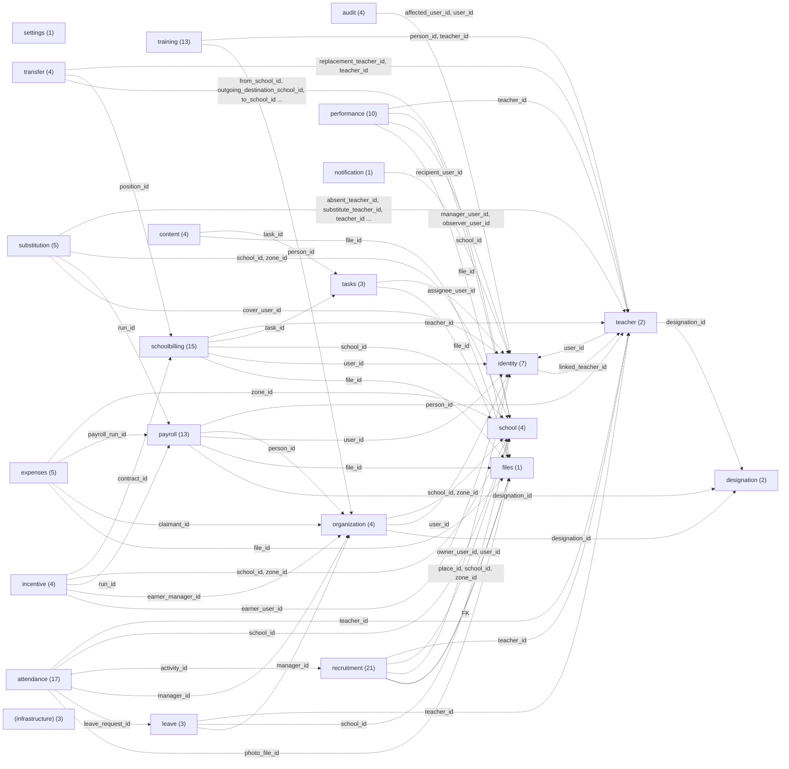

Modules without tables of their own: `activitycalendar` (Read model over manager_day, manager_day_activity and marketing_activity (spec 035)); `reporting` (Reports framework (spec 014a); reads other modules); `peoplereports` (People reports (spec 014c)); `schoolreports` (School reports and margin (spec 014b)); `cache` (Snapshot cache helpers (docs/caching.md))

### Cross-module link matrix

| From module | To module | Link |
|---|---|---|
| recruitment | files | real FK (1) |
| attendance | files | by id: `photo_file_id` |
| attendance | leave | by id: `leave_request_id` |
| attendance | organization | by id: `manager_id` |
| attendance | recruitment | by id: `activity_id` |
| attendance | school | by id: `school_id` |
| attendance | teacher | by id: `teacher_id` |
| audit | identity | by id: `affected_user_id`, `user_id` |
| content | files | by id: `file_id` |
| content | tasks | by id: `task_id` |
| expenses | files | by id: `file_id` |
| expenses | organization | by id: `claimant_id` |
| expenses | payroll | by id: `payroll_run_id` |
| expenses | school | by id: `zone_id` |
| identity | teacher | by id: `linked_teacher_id` |
| incentive | identity | by id: `earner_user_id` |
| incentive | organization | by id: `earner_manager_id` |
| incentive | payroll | by id: `run_id` |
| incentive | school | by id: `school_id`, `zone_id` |
| incentive | schoolbilling | by id: `contract_id` |
| leave | organization | by id: `manager_id` |
| leave | school | by id: `school_id` |
| leave | teacher | by id: `teacher_id` |
| notification | identity | by id: `recipient_user_id` |
| organization | designation | by id: `designation_id` |
| organization | identity | by id: `user_id` |
| organization | school | by id: `school_id`, `zone_id` |
| payroll | designation | by id: `designation_id` |
| payroll | files | by id: `file_id` |
| payroll | identity | by id: `user_id` |
| payroll | organization | by id: `person_id` |
| payroll | teacher | by id: `person_id` |
| performance | files | by id: `file_id` |
| performance | identity | by id: `manager_user_id`, `observer_user_id` |
| performance | school | by id: `school_id` |
| performance | teacher | by id: `teacher_id` |
| recruitment | identity | by id: `owner_user_id`, `user_id` |
| recruitment | school | by id: `place_id`, `school_id`, `zone_id` |
| recruitment | teacher | by id: `teacher_id` |
| schoolbilling | files | by id: `file_id` |
| schoolbilling | identity | by id: `user_id` |
| schoolbilling | school | by id: `school_id` |
| schoolbilling | tasks | by id: `task_id` |
| schoolbilling | teacher | by id: `teacher_id` |
| substitution | identity | by id: `cover_user_id` |
| substitution | payroll | by id: `run_id` |
| substitution | school | by id: `school_id`, `zone_id` |
| substitution | teacher | by id: `absent_teacher_id`, `substitute_teacher_id`, `teacher_id` |
| tasks | files | by id: `file_id` |
| tasks | identity | by id: `assignee_user_id` |
| teacher | designation | by id: `designation_id` |
| teacher | identity | by id: `user_id` |
| training | organization | by id: `person_id` |
| training | teacher | by id: `person_id`, `teacher_id` |
| transfer | school | by id: `from_school_id`, `outgoing_destination_school_id`, `to_school_id` |
| transfer | schoolbilling | by id: `position_id` |
| transfer | teacher | by id: `replacement_teacher_id`, `teacher_id` |

## 3. Modules

### 3.1 `identity` (7 tables)

Login accounts, roles, sessions and one-time codes (specs 001, 002, 004, 039).

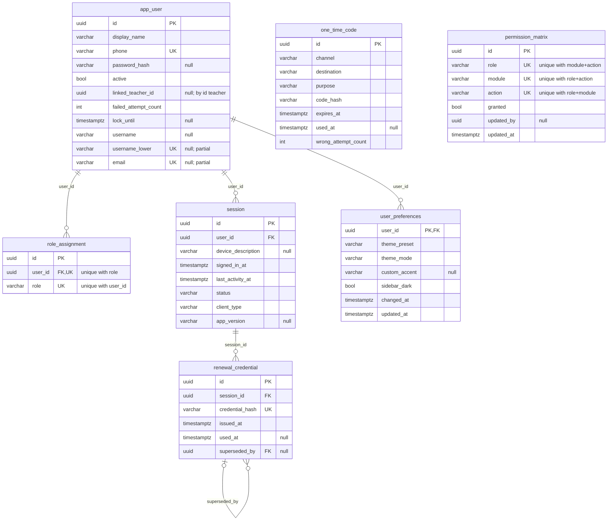

| Table | Purpose |
|---|---|
| `app_user` | Login account; optional link to a teacher via linked_teacher_id. |
| `role_assignment` | Roles granted to a user. |
| `session` | Authenticated sessions. |
| `renewal_credential` | Hashed renewal tokens of a session; rotation via superseded_by. |
| `one_time_code` | One-time codes (password set/reset, OTP). |
| `permission_matrix` | Role-to-permission matrix rows. |
| `user_preferences` | Per-user preferences such as theme (spec 039). |

Cross-module references from this module:

| Column | References | Kind |
|---|---|---|
| `app_user.linked_teacher_id` | `teacher` (teacher) | by id, no FK |

### 3.2 `audit` (4 tables)

Append-only audit trail: API access, change history, logins, user activity (spec 003).

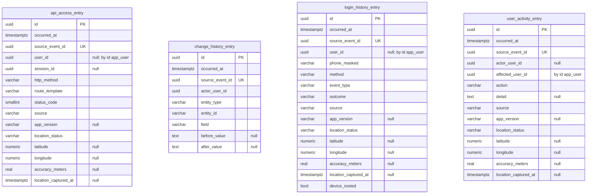

| Table | Purpose |
|---|---|
| `api_access_entry` | One row per audited API call. |
| `change_history_entry` | Record of changes to business entities. |
| `login_history_entry` | Login successes and failures. |
| `user_activity_entry` | User activity (admin actions on users). |

Cross-module references from this module:

| Column | References | Kind |
|---|---|---|
| `api_access_entry.user_id` | `app_user` (identity) | by id, no FK |
| `login_history_entry.user_id` | `app_user` (identity) | by id, no FK |
| `user_activity_entry.affected_user_id` | `app_user` (identity) | by id, no FK |

### 3.3 `settings` (1 tables)

System settings (spec 011).

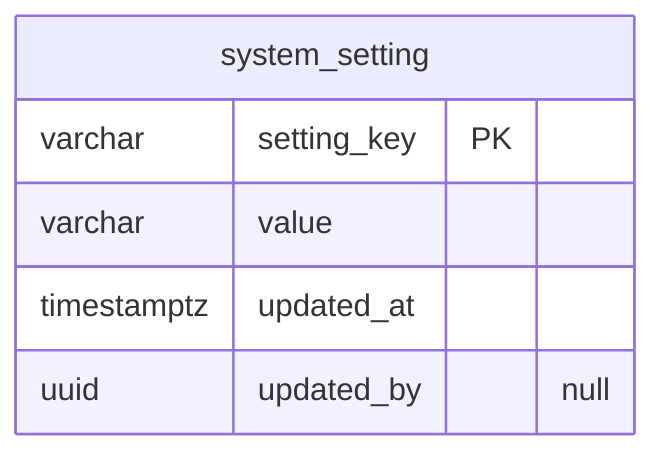

| Table | Purpose |
|---|---|
| `system_setting` | Key/value system settings. |

Cross-module references from this module:

None (apart from audit-stamp user columns).

### 3.4 `school` (4 tables)

Master data: zones, places, schools, school contacts (spec 005).

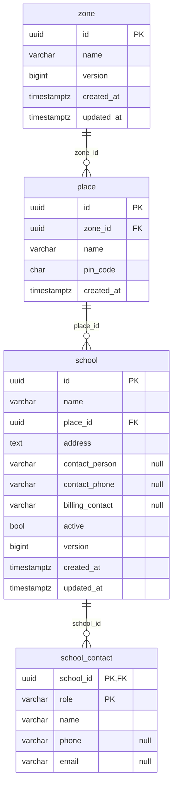

| Table | Purpose |
|---|---|
| `zone` | Operating zone. |
| `place` | Place (town or area) within a zone. |
| `school` | School master record (status, place). |
| `school_contact` | Contact persons of a school. |

Cross-module references from this module:

None (apart from audit-stamp user columns).

### 3.5 `organization` (4 tables)

Manager master data and manager assignment to zones, schools and designations (specs 005, 032).

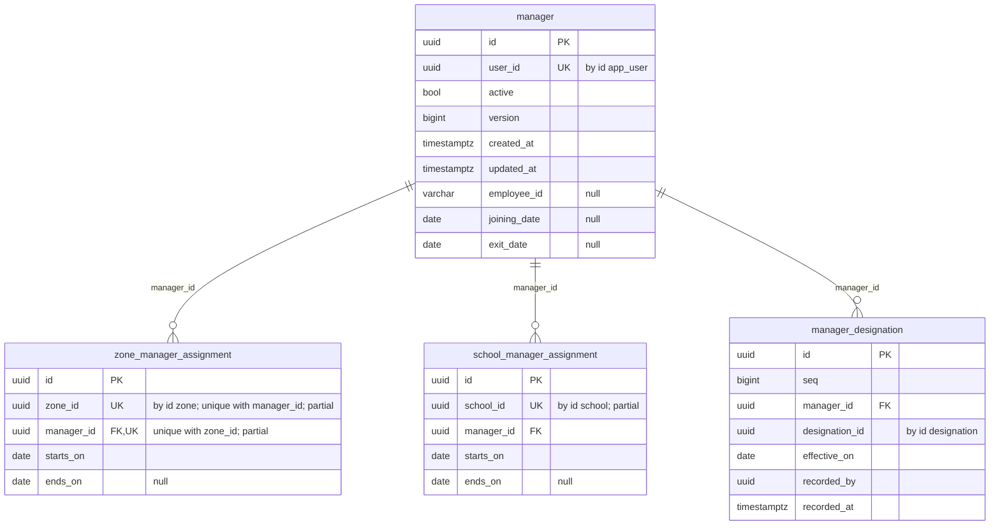

| Table | Purpose |
|---|---|
| `manager` | Manager (field employee); user_id links to app_user. |
| `manager_designation` | Dated history of a manager designation. |
| `zone_manager_assignment` | Manager responsible for a zone (current or historic). |
| `school_manager_assignment` | Manager responsible for a school (current or historic). |

Cross-module references from this module:

| Column | References | Kind |
|---|---|---|
| `manager.user_id` | `app_user` (identity) | by id, no FK |
| `manager_designation.designation_id` | `designation` (designation) | by id, no FK |
| `school_manager_assignment.school_id` | `school` (school) | by id, no FK |
| `zone_manager_assignment.zone_id` | `zone` (school) | by id, no FK |

### 3.6 `designation` (2 tables)

Designations (teacher and manager kinds) and the employee-id claim registry (spec 005a).

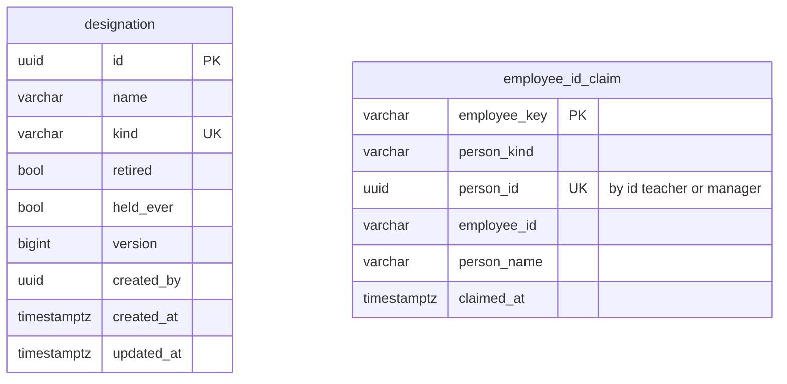

| Table | Purpose |
|---|---|
| `designation` | Designation master (kind + name). |
| `employee_id_claim` | Reserves employee ids so they stay unique across teachers and managers. |

Cross-module references from this module:

None (apart from audit-stamp user columns).

### 3.7 `teacher` (2 tables)

Teacher master data (specs 005, 013a).

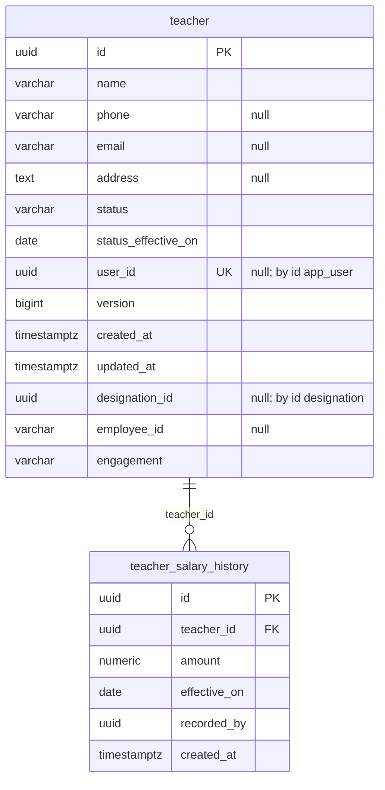

| Table | Purpose |
|---|---|
| `teacher` | Teacher record (status, designation, engagement, optional login user). |
| `teacher_salary_history` | Dated history of a teacher salary. |

Cross-module references from this module:

| Column | References | Kind |
|---|---|---|
| `teacher.user_id` | `app_user` (identity) | by id, no FK |
| `teacher.designation_id` | `designation` (designation) | by id, no FK |

### 3.8 `recruitment` (21 tables)

Campus recruitment (spec 016) plus the school marketing sub-package (spec 023), which lives in the same Java module (com.hls.recruitment.marketing).

#### Campus recruitment

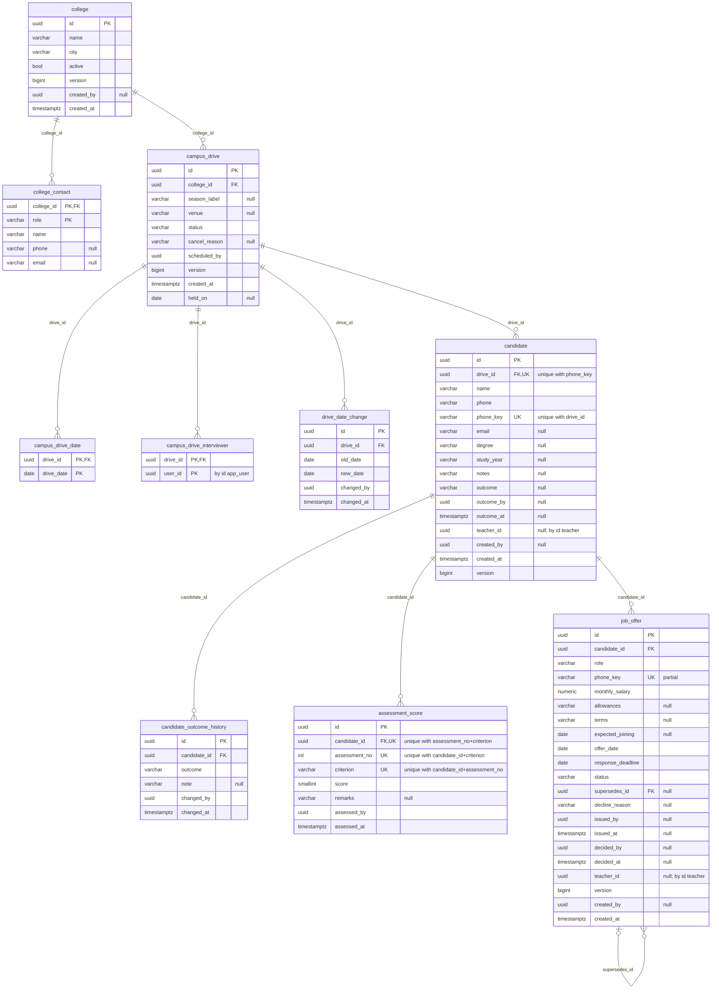

| Table | Purpose |
|---|---|
| `college` | College master. |
| `college_contact` | Contacts at a college. |
| `campus_drive` | A recruitment drive at a college. |
| `campus_drive_date` | Dates of a drive. |
| `campus_drive_interviewer` | Interviewers assigned to a drive. |
| `drive_date_change` | History of drive date changes. |
| `candidate` | Candidate met in a drive; may become a teacher. |
| `candidate_outcome_history` | Candidate outcome/stage history. |
| `assessment_score` | Assessment scores of a candidate. |
| `job_offer` | Offer letter to a candidate; teacher_id set once hired. |

#### School marketing

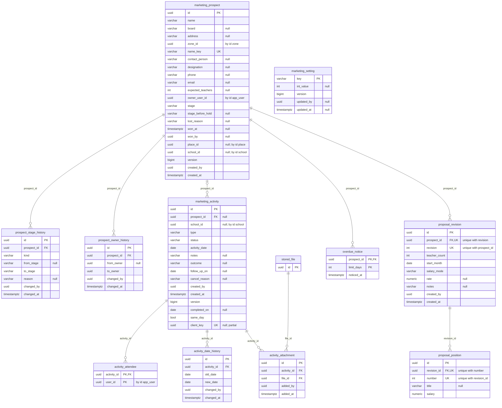

`stored_file` is drawn here only as a stub (it belongs to module `files`).

| Table | Purpose |
|---|---|
| `marketing_prospect` | Prospect school in the acquisition funnel. |
| `prospect_stage_history` | Prospect stage transitions. |
| `prospect_owner_history` | Prospect ownership (manager) changes. |
| `marketing_activity` | Visit, meeting or other marketing activity against a prospect. |
| `activity_attendee` | Attendees of an activity. |
| `activity_date_history` | Reschedule history of an activity. |
| `activity_attachment` | Files attached to an activity. |
| `proposal_revision` | Proposal revision sent to a prospect. |
| `proposal_position` | Positions proposed in a revision. |
| `overdue_notice` | Overdue notices for a prospect. |
| `marketing_setting` | Marketing configuration. |

Cross-module references from this module:

| Column | References | Kind |
|---|---|---|
| `activity_attendee.user_id` | `app_user` (identity) | by id, no FK |
| `campus_drive_interviewer.user_id` | `app_user` (identity) | by id, no FK |
| `candidate.teacher_id` | `teacher` (teacher) | by id, no FK |
| `job_offer.teacher_id` | `teacher` (teacher) | by id, no FK |
| `marketing_activity.school_id` | `school` (school) | by id, no FK |
| `marketing_prospect.zone_id` | `zone` (school) | by id, no FK |
| `marketing_prospect.owner_user_id` | `app_user` (identity) | by id, no FK |
| `marketing_prospect.place_id` | `place` (school) | by id, no FK |
| `marketing_prospect.school_id` | `school` (school) | by id, no FK |
| `activity_attachment.file_id` | `stored_file` (files) | **real DB FK** |

### 3.9 `training` (13 tables)

Induction batches and the recurring training calendar (specs 016, 024).

#### Induction

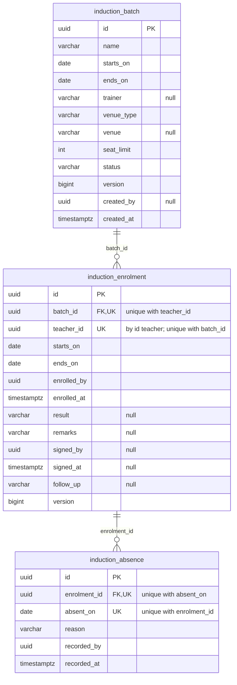

| Table | Purpose |
|---|---|
| `induction_batch` | Induction batch for new hires. |
| `induction_enrolment` | Teacher enrolled in a batch. |
| `induction_absence` | Absences of an enrolment. |

#### Training calendar

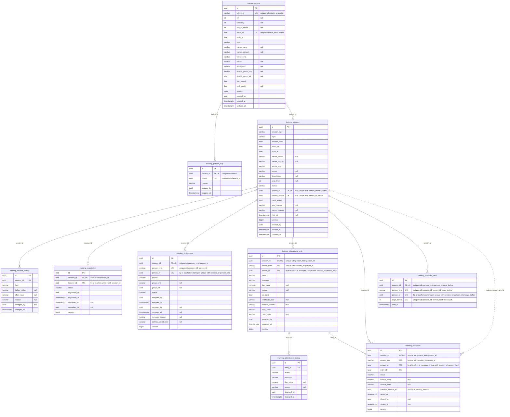

| Table | Purpose |
|---|---|
| `training_pattern` | Recurrence rule for training sessions. |
| `training_pattern_skip` | Dates skipped by a pattern. |
| `training_session` | A scheduled training session. |
| `training_session_history` | Session change history. |
| `training_registration` | Teacher registration for a session. |
| `training_assignment` | Person assigned to a session. |
| `training_attendance_entry` | Attendance of a person at a session. |
| `training_attendance_history` | Attendance correction history. |
| `training_exception` | Session exception (cancellation, make-up). |
| `training_reminder_sent` | Reminders already sent (idempotency). |

Cross-module references from this module:

| Column | References | Kind |
|---|---|---|
| `induction_enrolment.teacher_id` | `teacher` (teacher) | by id, no FK |
| `training_registration.teacher_id` | `teacher` (teacher) | by id, no FK |
| `training_assignment.person_id` | `teacher` or `manager` (per `person_kind`) | by id, no FK |
| `training_attendance_entry.person_id` | `teacher` or `manager` (per `person_kind`) | by id, no FK |
| `training_exception.person_id` | `teacher` or `manager` (per `person_kind`) | by id, no FK |
| `training_reminder_sent.person_id` | `teacher` or `manager` (per `person_kind`) | by id, no FK |

### 3.10 `attendance` (17 tables)

Teacher daily attendance, monthly working days, school calendar and manager attendance (specs 008, 032, 037, 038, 040).

#### Teacher attendance and working days

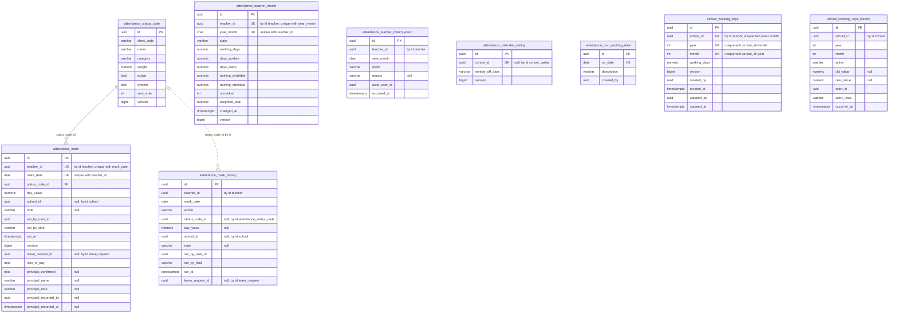

| Table | Purpose |
|---|---|
| `attendance_status_code` | Attendance status codes. |
| `attendance_mark` | Daily mark of a teacher at a school. |
| `attendance_mark_history` | Mark change history. |
| `attendance_teacher_month` | Teacher monthly attendance summary and lock. |
| `attendance_teacher_month_event` | Monthly summary events. |
| `attendance_calendar_setting` | Weekly-off and calendar rules (default and per school). |
| `attendance_non_working_date` | Holidays and non-working dates. |
| `school_working_days` | Declared working days per school per month (specs 037, 038). |
| `school_working_days_history` | History of working-days changes. |

#### Manager attendance and field days

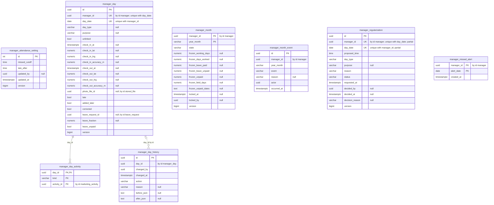

| Table | Purpose |
|---|---|
| `manager_attendance_setting` | Manager attendance configuration. |
| `manager_day` | Manager daily attendance and visit day. |
| `manager_day_activity` | Activities recorded in a manager day. |
| `manager_day_history` | Day change history. |
| `manager_month` | Manager monthly summary and lock. |
| `manager_month_event` | Monthly summary events. |
| `manager_regularization` | Regularisation requests for missed days. |
| `manager_missed_alert` | Alerts for missed marking. |

Cross-module references from this module:

| Column | References | Kind |
|---|---|---|
| `attendance_calendar_setting.school_id` | `school` (school) | by id, no FK |
| `attendance_mark.teacher_id` | `teacher` (teacher) | by id, no FK |
| `attendance_mark.school_id` | `school` (school) | by id, no FK |
| `attendance_mark.leave_request_id` | `leave_request` (leave) | by id, no FK |
| `attendance_mark_history.teacher_id` | `teacher` (teacher) | by id, no FK |
| `attendance_mark_history.school_id` | `school` (school) | by id, no FK |
| `attendance_mark_history.leave_request_id` | `leave_request` (leave) | by id, no FK |
| `attendance_teacher_month.teacher_id` | `teacher` (teacher) | by id, no FK |
| `attendance_teacher_month_event.teacher_id` | `teacher` (teacher) | by id, no FK |
| `manager_day.manager_id` | `manager` (organization) | by id, no FK |
| `manager_day.photo_file_id` | `stored_file` (files) | by id, no FK |
| `manager_day.leave_request_id` | `leave_request` (leave) | by id, no FK |
| `manager_day_activity.activity_id` | `marketing_activity` (recruitment) | by id, no FK |
| `manager_missed_alert.manager_id` | `manager` (organization) | by id, no FK |
| `manager_month.manager_id` | `manager` (organization) | by id, no FK |
| `manager_month_event.manager_id` | `manager` (organization) | by id, no FK |
| `manager_regularization.manager_id` | `manager` (organization) | by id, no FK |
| `school_working_days.school_id` | `school` (school) | by id, no FK |
| `school_working_days_history.school_id` | `school` (school) | by id, no FK |

### 3.11 `leave` (3 tables)

Leave types and leave requests for teachers and managers (specs 009, 020, 032).

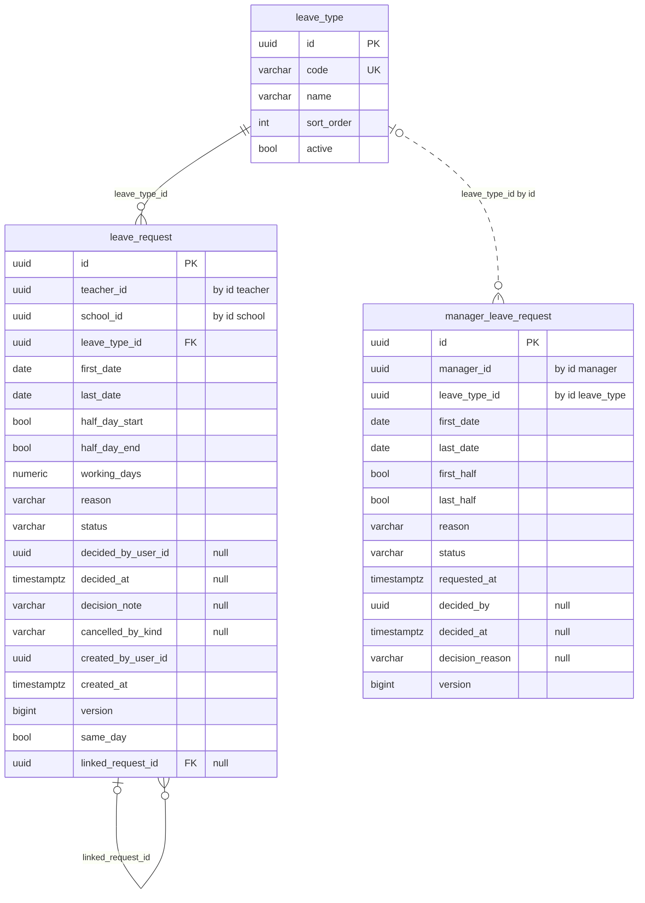

| Table | Purpose |
|---|---|
| `leave_type` | Leave type master. |
| `leave_request` | Teacher leave request (can link to a related request). |
| `manager_leave_request` | Manager leave request. |

Cross-module references from this module:

| Column | References | Kind |
|---|---|---|
| `leave_request.teacher_id` | `teacher` (teacher) | by id, no FK |
| `leave_request.school_id` | `school` (school) | by id, no FK |
| `manager_leave_request.manager_id` | `manager` (organization) | by id, no FK |

### 3.12 `payroll` (13 tables)

Salary structures, pay policy, payroll runs, adjustments, payslips and payments (specs 013a, 013b).

#### Salary structures

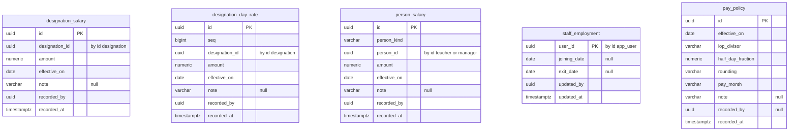

| Table | Purpose |
|---|---|
| `designation_salary` | Salary by designation (effective dated). |
| `designation_day_rate` | Per-day rate by designation (substitute pay). |
| `person_salary` | Individual salary per person_kind/person_id. |
| `staff_employment` | Joining and exit dates of a user. |
| `pay_policy` | Pay policy parameters. |

#### Payroll run

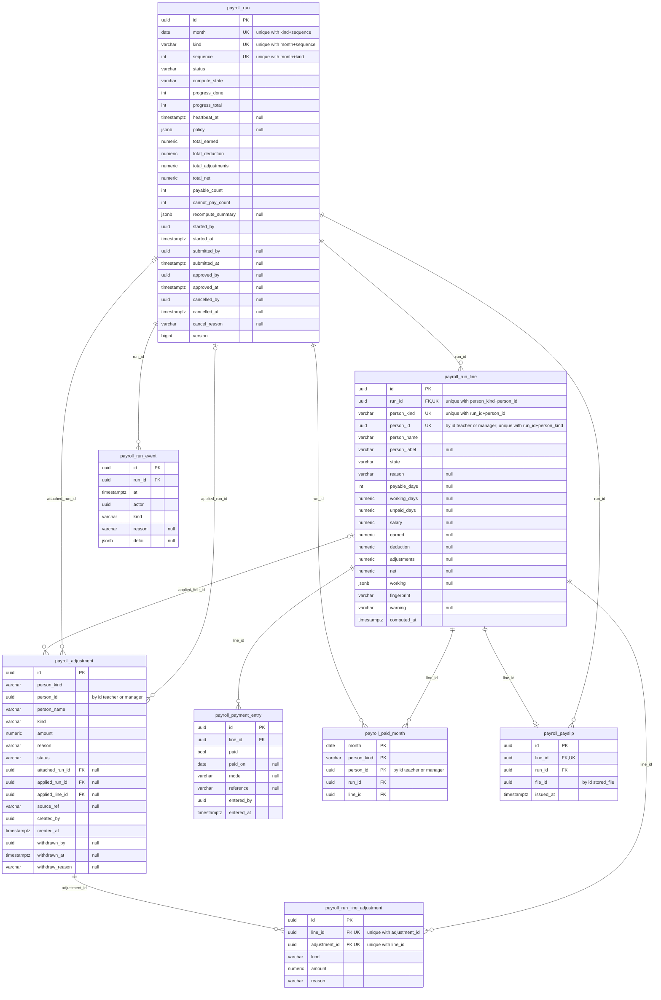

| Table | Purpose |
|---|---|
| `payroll_run` | Monthly payroll run (primary or supplementary). |
| `payroll_run_line` | Per-person computed line of a run. |
| `payroll_run_event` | Run lifecycle events. |
| `payroll_adjustment` | Adjustment attached to and applied in runs. |
| `payroll_run_line_adjustment` | Join between a line and the adjustments it contains. |
| `payroll_payment_entry` | Payment entries against a line. |
| `payroll_paid_month` | Marks a (person, month) as paid via a line and run. |
| `payroll_payslip` | Payslip for a line (stored file). |

Cross-module references from this module:

| Column | References | Kind |
|---|---|---|
| `designation_day_rate.designation_id` | `designation` (designation) | by id, no FK |
| `designation_salary.designation_id` | `designation` (designation) | by id, no FK |
| `payroll_payslip.file_id` | `stored_file` (files) | by id, no FK |
| `staff_employment.user_id` | `app_user` (identity) | by id, no FK |
| `payroll_adjustment.person_id` | `teacher` or `manager` (per `person_kind`) | by id, no FK |
| `payroll_paid_month.person_id` | `teacher` or `manager` (per `person_kind`) | by id, no FK |
| `payroll_run_line.person_id` | `teacher` or `manager` (per `person_kind`) | by id, no FK |
| `person_salary.person_id` | `teacher` or `manager` (per `person_kind`) | by id, no FK |

### 3.13 `substitution` (5 tables)

Substitute teacher requirements, day pay and month locks (specs 017a, 017b, 040).

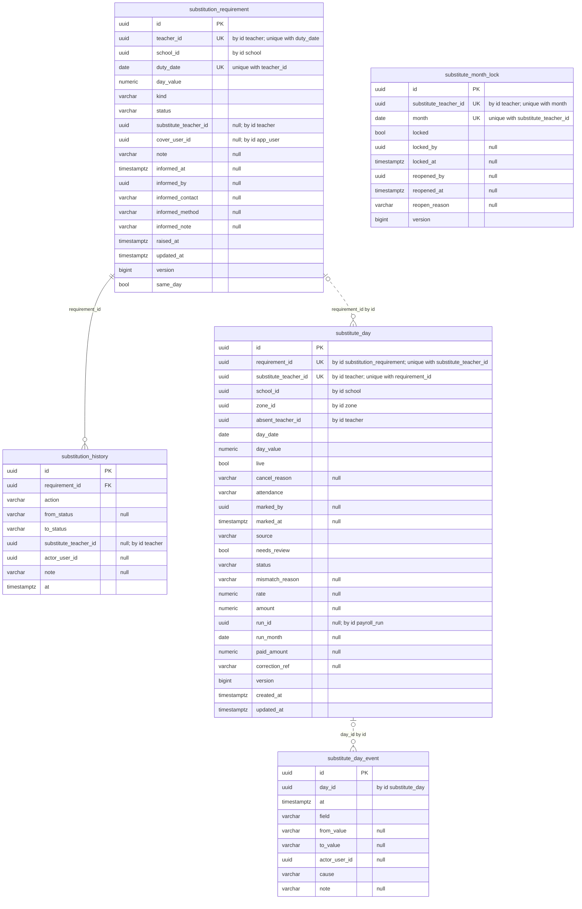

| Table | Purpose |
|---|---|
| `substitution_requirement` | Need for cover for an absent teacher on a duty date. |
| `substitution_history` | Requirement change history. |
| `substitute_day` | A substitute day worked (attendance, rate, amount, payroll run). |
| `substitute_day_event` | Events on a substitute day. |
| `substitute_month_lock` | Month lock per substitute teacher once paid. |

Cross-module references from this module:

| Column | References | Kind |
|---|---|---|
| `substitute_day.substitute_teacher_id` | `teacher` (teacher) | by id, no FK |
| `substitute_day.school_id` | `school` (school) | by id, no FK |
| `substitute_day.zone_id` | `zone` (school) | by id, no FK |
| `substitute_day.absent_teacher_id` | `teacher` (teacher) | by id, no FK |
| `substitute_day.run_id` | `payroll_run` (payroll) | by id, no FK |
| `substitute_month_lock.substitute_teacher_id` | `teacher` (teacher) | by id, no FK |
| `substitution_history.substitute_teacher_id` | `teacher` (teacher) | by id, no FK |
| `substitution_requirement.teacher_id` | `teacher` (teacher) | by id, no FK |
| `substitution_requirement.school_id` | `school` (school) | by id, no FK |
| `substitution_requirement.substitute_teacher_id` | `teacher` (teacher) | by id, no FK |
| `substitution_requirement.cover_user_id` | `app_user` (identity) | by id, no FK |

### 3.14 `schoolbilling` (15 tables)

School contracts, MoU approval and documents, monthly dues, collections and overdue follow-up (specs 012, 022, 023, 031).

#### Contracts and MoU

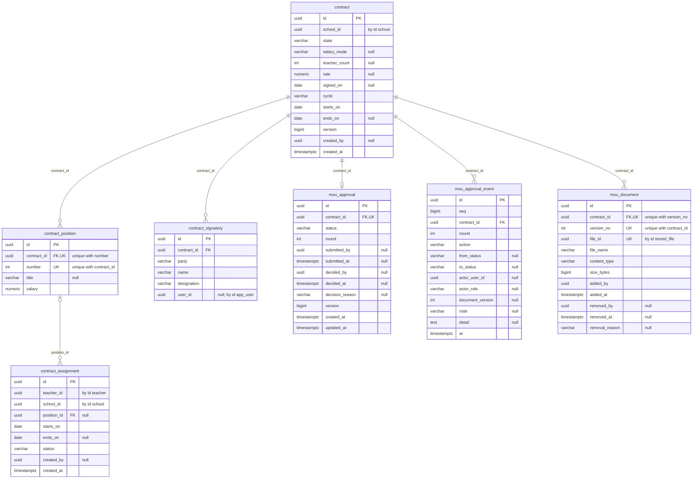

| Table | Purpose |
|---|---|
| `contract` | School contract (MoU). |
| `contract_position` | Positions covered by a contract. |
| `contract_signatory` | Signatories of a contract. |
| `contract_assignment` | Teacher assigned to a contract position (dated). |
| `mou_approval` | Approval state of a contract MoU. |
| `mou_approval_event` | Approval events. |
| `mou_document` | Document versions of an MoU (stored file). |

#### Dues and collections

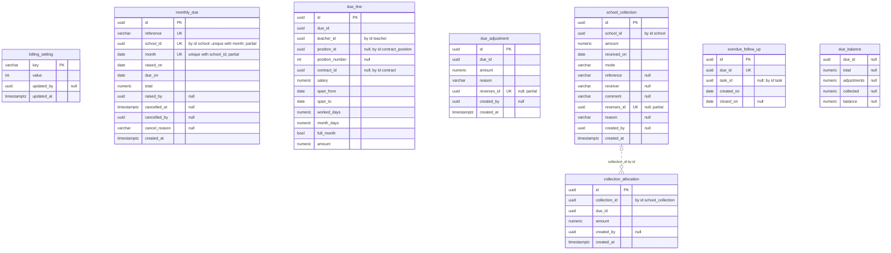

| Table | Purpose |
|---|---|
| `billing_setting` | Billing configuration. |
| `monthly_due` | Invoice/due raised for a school and month. |
| `due_line` | Line of a due (per position and teacher). |
| `due_adjustment` | Adjustment (or reversal) against a due. |
| `school_collection` | Payment collected from a school (or reversal). |
| `collection_allocation` | Allocation of a collection to dues. |
| `overdue_follow_up` | Follow-up of an overdue due (may create a task). |
| `due_balance` (view) | VIEW: total, adjustments, collected and balance per due. |

Cross-module references from this module:

| Column | References | Kind |
|---|---|---|
| `contract.school_id` | `school` (school) | by id, no FK |
| `contract_assignment.teacher_id` | `teacher` (teacher) | by id, no FK |
| `contract_assignment.school_id` | `school` (school) | by id, no FK |
| `contract_signatory.user_id` | `app_user` (identity) | by id, no FK |
| `due_line.teacher_id` | `teacher` (teacher) | by id, no FK |
| `monthly_due.school_id` | `school` (school) | by id, no FK |
| `mou_document.file_id` | `stored_file` (files) | by id, no FK |
| `overdue_follow_up.task_id` | `task` (tasks) | by id, no FK |
| `school_collection.school_id` | `school` (school) | by id, no FK |

### 3.15 `expenses` (5 tables)

Expense claims, bills and area budgets (specs 015, 036).

```mermaid
erDiagram
    expense_claim {
        uuid id PK
        uuid claimant_id UK "by id manager; unique with client_request_id"
        uuid client_request_id UK "unique with claimant_id"
        date expense_date 
        numeric amount 
        varchar category 
        uuid zone_id  "null; by id zone"
        varchar note  "null"
        varchar paid_by 
        varchar reason  "null"
        varchar no_bill_reason  "null"
        varchar link_kind  "null"
        uuid link_ref  "null"
        date link_date  "null"
        varchar link_label  "null"
        varchar status 
        varchar paid_how  "null"
        timestamptz submitted_at  "null"
        uuid decided_by  "null"
        timestamptz decided_at  "null"
        varchar decision_reason  "null"
        date paid_on  "null"
        varchar paid_mode  "null"
        varchar paid_reference  "null"
        uuid paid_by_user  "null"
        uuid payroll_run_id  "null; by id payroll_run"
        date payroll_month  "null"
        bigint version 
        timestamptz created_at 
        uuid created_by 
        timestamptz updated_at 
    }
    expense_bill {
        uuid id PK
        uuid claim_id FK
        uuid file_id  "by id stored_file"
        varchar name 
        varchar content_type  "null"
        bigint size_bytes  "null"
        uuid added_by 
        timestamptz added_at 
        uuid removed_by  "null"
        timestamptz removed_at  "null"
        varchar removal_reason  "null"
    }
    expense_claim_event {
        uuid id PK
        uuid claim_id  "by id expense_claim"
        timestamptz at 
        uuid actor_id  "null"
        varchar event 
        varchar reason  "null"
        varchar detail  "null"
    }
    expense_area_budget {
        uuid id PK
        uuid zone_id  "null; by id zone"
        date month UK
        numeric amount 
        bigint version 
        timestamptz updated_at 
        uuid updated_by 
    }
    expense_budget_change {
        uuid id PK
        uuid budget_id FK
        timestamptz at 
        uuid actor_id 
        numeric old_amount  "null"
        numeric new_amount 
    }
    expense_claim ||--o{ expense_bill : "claim_id"
    expense_area_budget ||--o{ expense_budget_change : "budget_id"
    expense_claim |o..o{ expense_claim_event : "claim_id by id"
```

| Table | Purpose |
|---|---|
| `expense_claim` | Expense claim by a claimant. |
| `expense_bill` | Bill (file) of a claim. |
| `expense_claim_event` | Claim lifecycle events. |
| `expense_area_budget` | Budget per zone. |
| `expense_budget_change` | Budget change history. |

Cross-module references from this module:

| Column | References | Kind |
|---|---|---|
| `expense_area_budget.zone_id` | `zone` (school) | by id, no FK |
| `expense_bill.file_id` | `stored_file` (files) | by id, no FK |
| `expense_claim.claimant_id` | `manager` (organization) | by id, no FK |
| `expense_claim.zone_id` | `zone` (school) | by id, no FK |
| `expense_claim.payroll_run_id` | `payroll_run` (payroll) | by id, no FK |

### 3.16 `transfer` (4 tables)

Teacher transfer and replacement requests (spec 027).

```mermaid
erDiagram
    movement_request {
        uuid id PK
        varchar kind 
        uuid teacher_id  "by id teacher"
        uuid from_school_id  "by id school"
        uuid to_school_id  "by id school"
        uuid position_id  "null; by id contract_position"
        uuid replacement_teacher_id  "null; by id teacher"
        uuid outgoing_destination_school_id  "null; by id school"
        date effective_on 
        varchar reason_category 
        varchar note  "null"
        varchar status 
        uuid requested_by 
        timestamptz requested_at 
        uuid decided_by  "null"
        timestamptz decided_at  "null"
        varchar decision_reason  "null"
        timestamptz applied_notified_at  "null"
        bigint version 
        timestamptz created_at 
        timestamptz updated_at 
    }
    movement_request_history {
        uuid id PK
        uuid request_id  "by id movement_request"
        varchar action 
        varchar from_status  "null"
        varchar to_status  "null"
        uuid actor_user_id  "null"
        varchar note  "null"
        timestamptz at 
    }
    movement_assignment {
        uuid id PK
        uuid request_id UK "by id movement_request; unique with assignment_id"
        uuid assignment_id UK "by id movement_assignment; unique with request_id"
        uuid teacher_id  "by id teacher"
        varchar effect 
    }
    movement_participant {
        uuid id PK
        uuid request_id  "by id movement_request"
        uuid teacher_id UK "by id teacher; partial"
        varchar role 
        bool open 
    }
    movement_request |o..o{ movement_assignment : "request_id by id"
    movement_request |o..o{ movement_participant : "request_id by id"
    movement_request |o..o{ movement_request_history : "request_id by id"
```

| Table | Purpose |
|---|---|
| `movement_request` | Transfer or replacement request. |
| `movement_request_history` | Request history. |
| `movement_assignment` | Resulting assignment of a teacher. |
| `movement_participant` | Teachers participating in a request. |

Cross-module references from this module:

| Column | References | Kind |
|---|---|---|
| `movement_assignment.teacher_id` | `teacher` (teacher) | by id, no FK |
| `movement_participant.teacher_id` | `teacher` (teacher) | by id, no FK |
| `movement_request.teacher_id` | `teacher` (teacher) | by id, no FK |
| `movement_request.from_school_id` | `school` (school) | by id, no FK |
| `movement_request.to_school_id` | `school` (school) | by id, no FK |
| `movement_request.position_id` | `contract_position` (schoolbilling) | by id, no FK |
| `movement_request.replacement_teacher_id` | `teacher` (teacher) | by id, no FK |
| `movement_request.outgoing_destination_school_id` | `school` (school) | by id, no FK |

### 3.17 `tasks` (3 tables)

Manager tasks with evidence (specs 025, 034).

```mermaid
erDiagram
    task {
        uuid id PK
        varchar type 
        varchar title 
        varchar description  "null"
        uuid assignee_user_id  "by id app_user"
        uuid created_by  "null"
        date due_on 
        int escalate_after_days 
        varchar status 
        varchar linked_type  "null"
        uuid linked_id  "null"
        varchar linked_label  "null"
        varchar place  "null"
        varchar source UK "unique with source_key; partial"
        varchar source_key UK "null; unique with source; partial"
        uuid parent_task_id  "null; by id task"
        varchar overdue_reason  "null"
        varchar completion_note  "null"
        timestamptz completed_at  "null"
        timestamptz verified_at  "null"
        uuid verified_by  "null"
        date overdue_notified_for  "null"
        timestamptz escalated_at  "null"
        varchar cancel_reason  "null"
        bigint version 
        timestamptz created_at 
        timestamptz updated_at 
        bool same_day 
        uuid client_key UK "null; partial"
    }
    task_history {
        uuid id PK
        uuid task_id FK
        varchar event 
        uuid actor_user_id  "null"
        timestamptz at 
        varchar before_value  "null"
        varchar after_value  "null"
        varchar note  "null"
    }
    task_evidence {
        uuid id PK
        uuid task_id FK
        uuid file_id UK "by id stored_file"
        uuid added_by 
        timestamptz added_at 
    }
    task ||--o{ task_history : "task_id"
    task ||--o{ task_evidence : "task_id"
```

| Table | Purpose |
|---|---|
| `task` | Task assigned to a user (parent task and source key supported). |
| `task_history` | Task history. |
| `task_evidence` | Evidence files of a task. |

Cross-module references from this module:

| Column | References | Kind |
|---|---|---|
| `task.assignee_user_id` | `app_user` (identity) | by id, no FK |
| `task_evidence.file_id` | `stored_file` (files) | by id, no FK |

### 3.18 `incentive` (4 tables)

Manager incentives on school contract closure (spec 030).

```mermaid
erDiagram
    incentive_program {
        smallint id PK
        timestamptz starts_at 
    }
    incentive {
        uuid id PK
        uuid school_id UK "by id school"
        uuid contract_id  "by id contract"
        uuid earner_manager_id  "by id manager"
        uuid earner_user_id  "by id app_user"
        numeric amount 
        date closure_date 
        varchar status 
        bool mou_changed 
        uuid decided_by  "null"
        timestamptz decided_at  "null"
        bool approved_by_earner 
        varchar reject_reason  "null"
        varchar hold_reason  "null"
        uuid run_id  "null; by id payroll_run"
        date run_month  "null"
        uuid zone_id  "by id zone"
        bigint version 
        timestamptz created_at 
        timestamptz updated_at 
    }
    incentive_event {
        uuid id PK
        bigint seq 
        uuid incentive_id  "by id incentive"
        varchar kind 
        uuid actor_id  "null"
        varchar detail  "null"
        timestamptz created_at 
    }
    no_earner {
        uuid id PK
        uuid school_id UK "by id school"
        uuid contract_id  "null; by id contract"
        varchar reason 
        varchar detail  "null"
        timestamptz resolved_at  "null"
        timestamptz created_at 
    }
    incentive |o..o{ incentive_event : "incentive_id by id"
```

| Table | Purpose |
|---|---|
| `incentive_program` | Incentive program parameters. |
| `incentive` | Incentive earned by a manager for a school contract. |
| `incentive_event` | Incentive events. |
| `no_earner` | Contracts with no eligible earner. |

Cross-module references from this module:

| Column | References | Kind |
|---|---|---|
| `incentive.school_id` | `school` (school) | by id, no FK |
| `incentive.contract_id` | `contract` (schoolbilling) | by id, no FK |
| `incentive.earner_manager_id` | `manager` (organization) | by id, no FK |
| `incentive.earner_user_id` | `app_user` (identity) | by id, no FK |
| `incentive.run_id` | `payroll_run` (payroll) | by id, no FK |
| `incentive.zone_id` | `zone` (school) | by id, no FK |
| `no_earner.school_id` | `school` (school) | by id, no FK |
| `no_earner.contract_id` | `contract` (schoolbilling) | by id, no FK |

### 3.19 `performance` (10 tables)

Classroom observation, principal feedback, performance issues and corrective actions (spec 026).

```mermaid
erDiagram
    observation {
        uuid id PK
        uuid root_id UK "by id observation; partial"
        int version_no 
        bool current 
        uuid teacher_id  "by id teacher"
        uuid school_id  "by id school"
        uuid observer_user_id  "by id app_user"
        varchar observer_name 
        uuid manager_user_id  "null; by id app_user"
        date observed_on 
        varchar class_name  "null"
        varchar subject  "null"
        int duration_minutes  "null"
        varchar status 
        varchar not_held_reason  "null"
        varchar not_held_text  "null"
        varchar overall_result  "null"
        numeric average_rating  "null"
        varchar suggested_result  "null"
        varchar comments  "null"
        varchar strengths  "null"
        varchar improvements  "null"
        varchar principal_comments  "null"
        varchar permission_by  "null"
        varchar permission_way  "null"
        date permission_on  "null"
        uuid issue_id  "null; by id performance_issue"
        uuid followup_of_issue_id  "null; by id performance_issue"
        varchar correction_reason  "null"
        timestamptz submitted_at  "null"
        bigint version 
        timestamptz created_at 
        timestamptz updated_at 
    }
    observation_rating {
        uuid observation_id PK,FK
        varchar area PK
        int rating  "null"
    }
    observation_attachment {
        uuid id PK
        uuid observation_id FK
        uuid file_id  "by id stored_file"
        varchar name 
        uuid added_by 
        timestamptz added_at 
    }
    observation_plan {
        uuid id PK
        uuid teacher_id UK "by id teacher; partial"
        uuid school_id  "by id school"
        date planned_on 
        varchar reason 
        varchar reason_text  "null"
        uuid planned_by 
        uuid source_feedback_root_id  "null; by id principal_feedback"
        uuid issue_id  "null; by id performance_issue"
        varchar task_source 
        varchar task_source_key 
        varchar status 
        uuid completed_by_observation_root_id  "null; by id observation"
        varchar cancel_reason  "null"
        bigint version 
        timestamptz created_at 
        timestamptz updated_at 
    }
    principal_feedback {
        uuid id PK
        uuid root_id UK "by id principal_feedback; partial"
        int version_no 
        bool current 
        uuid teacher_id  "by id teacher"
        uuid school_id  "by id school"
        varchar principal_name 
        date given_on 
        varchar category 
        varchar comments 
        bool action_required 
        uuid observation_root_id  "null; by id observation"
        uuid recorded_by 
        varchar status 
        varchar withdrawn_reason  "null"
        uuid withdrawn_by  "null"
        timestamptz withdrawn_at  "null"
        uuid issue_id  "null; by id performance_issue"
        varchar correction_reason  "null"
        bigint version 
        timestamptz created_at 
        timestamptz updated_at 
    }
    performance_issue {
        uuid id PK
        uuid teacher_id UK "by id teacher; partial"
        uuid school_id  "by id school"
        uuid manager_user_id  "null; by id app_user"
        varchar source_type 
        uuid source_root_id  "by id observation"
        varchar category 
        varchar status 
        varchar resolution  "null"
        int correction_rounds 
        uuid opened_by  "null"
        date opened_on 
        uuid closed_by  "null"
        date closed_on  "null"
        varchar closing_reason  "null"
        bigint version 
        timestamptz created_at 
        timestamptz updated_at 
    }
    issue_link {
        uuid id PK
        uuid issue_id FK,UK "unique with record_type+record_root_id"
        varchar record_type UK "unique with issue_id+record_root_id"
        uuid record_root_id UK "by id observation; unique with issue_id+record_type"
        date linked_on 
    }
    corrective_action {
        uuid id PK
        uuid issue_id FK,UK "unique with round_no"
        int round_no UK "unique with issue_id"
        varchar discussed 
        varchar required_change 
        date follow_up_on 
        uuid recorded_by 
        date recorded_on 
        varchar follow_up_source_key 
        uuid follow_up_observation_root_id  "null; by id observation"
    }
    referral {
        uuid id PK
        uuid issue_id FK,UK
        varchar recommendation 
        varchar reason 
        uuid referred_by 
        date referred_on 
        varchar decision_outcome  "null"
        date decision_reported_on  "null"
    }
    performance_history {
        uuid id PK
        varchar record_type 
        uuid record_id  "by id observation"
        uuid teacher_id  "by id teacher"
        varchar event 
        uuid actor_user_id  "null"
        varchar actor_name  "null"
        timestamptz at 
        text before_json  "null"
        text after_json  "null"
        varchar note  "null"
    }
    observation ||--o{ observation_rating : "observation_id"
    observation ||--o{ observation_attachment : "observation_id"
    performance_issue ||--o{ issue_link : "issue_id"
    performance_issue ||--o{ corrective_action : "issue_id"
    performance_issue ||--o| referral : "issue_id"
    observation |o..o{ corrective_action : "follow_up_observation_root_id by id"
    observation |o..o{ issue_link : "record_root_id by id"
    performance_issue |o..o{ observation : "issue_id by id"
    performance_issue |o..o{ observation : "followup_of_issue_id by id"
    principal_feedback |o..o{ observation_plan : "source_feedback_root_id by id"
    performance_issue |o..o{ observation_plan : "issue_id by id"
    observation |o..o{ observation_plan : "completed_by_observation_root_id by id"
    observation |o..o{ performance_history : "record_id by id"
    observation |o..o{ performance_issue : "source_root_id by id"
    observation |o..o{ principal_feedback : "observation_root_id by id"
    performance_issue |o..o{ principal_feedback : "issue_id by id"
```

| Table | Purpose |
|---|---|
| `observation` | Classroom observation (versioned by root id). |
| `observation_rating` | Ratings within an observation. |
| `observation_attachment` | Attachments of an observation. |
| `observation_plan` | Observation plan for a teacher. |
| `principal_feedback` | Principal feedback on a teacher. |
| `performance_issue` | Performance issue raised for a teacher. |
| `issue_link` | Links records to an issue. |
| `corrective_action` | Corrective action of an issue. |
| `referral` | Referral of an issue. |
| `performance_history` | Performance record history. |

Cross-module references from this module:

| Column | References | Kind |
|---|---|---|
| `observation.teacher_id` | `teacher` (teacher) | by id, no FK |
| `observation.school_id` | `school` (school) | by id, no FK |
| `observation.observer_user_id` | `app_user` (identity) | by id, no FK |
| `observation.manager_user_id` | `app_user` (identity) | by id, no FK |
| `observation_attachment.file_id` | `stored_file` (files) | by id, no FK |
| `observation_plan.teacher_id` | `teacher` (teacher) | by id, no FK |
| `observation_plan.school_id` | `school` (school) | by id, no FK |
| `performance_history.teacher_id` | `teacher` (teacher) | by id, no FK |
| `performance_issue.teacher_id` | `teacher` (teacher) | by id, no FK |
| `performance_issue.school_id` | `school` (school) | by id, no FK |
| `performance_issue.manager_user_id` | `app_user` (identity) | by id, no FK |
| `principal_feedback.teacher_id` | `teacher` (teacher) | by id, no FK |
| `principal_feedback.school_id` | `school` (school) | by id, no FK |

### 3.20 `content` (4 tables)

Content preparation, versions and review (spec 029).

```mermaid
erDiagram
    content {
        uuid id PK
        varchar code UK
        varchar title 
        varchar category 
        varchar subject 
        varchar description  "null"
        uuid author_user_id 
        uuid created_by_user_id 
        date due_on  "null"
        varchar status 
        int current_version 
        int last_approved_version  "null"
        uuid reviewer_user_id  "null"
        date approved_on  "null"
        uuid task_id  "null; by id task"
        int no_reviewer_notified_version  "null"
        bigint version 
        timestamptz created_at 
        timestamptz updated_at 
    }
    content_version {
        uuid id PK
        uuid content_id FK,UK "unique with number"
        int number UK "unique with content_id"
        uuid file_id UK "by id stored_file"
        varchar file_name 
        varchar content_type 
        bigint size_bytes 
        uuid author_user_id 
        uuid submitted_by_user_id 
        varchar note  "null"
        timestamptz submitted_at 
        uuid removed_by  "null"
        timestamptz removed_at  "null"
        varchar removal_reason  "null"
    }
    content_review {
        uuid id PK
        uuid content_id FK
        int version_number 
        uuid reviewer_user_id 
        varchar decision 
        varchar comment  "null"
        timestamptz decided_at 
    }
    content_history {
        uuid id PK
        uuid content_id FK
        varchar event 
        uuid actor_user_id  "null"
        timestamptz at 
        varchar before_value  "null"
        varchar after_value  "null"
        varchar note  "null"
    }
    content ||--o{ content_version : "content_id"
    content ||--o{ content_review : "content_id"
    content ||--o{ content_history : "content_id"
```

| Table | Purpose |
|---|---|
| `content` | Content item. |
| `content_version` | Version of a content item (stored file). |
| `content_review` | Review of a content item. |
| `content_history` | Content history. |

Cross-module references from this module:

| Column | References | Kind |
|---|---|---|
| `content.task_id` | `task` (tasks) | by id, no FK |
| `content_version.file_id` | `stored_file` (files) | by id, no FK |

### 3.21 `notification` (1 tables)

In-app notifications (specs 010, 021).

```mermaid
erDiagram
    notification {
        uuid id PK
        uuid recipient_user_id  "by id app_user"
        varchar type 
        varchar title 
        varchar message 
        varchar link  "null"
        varchar channel 
        varchar group_key  "null"
        varchar detail  "null"
        timestamptz created_at 
        timestamptz updated_at 
        timestamptz read_at  "null"
    }
```

| Table | Purpose |
|---|---|
| `notification` | Notification for a recipient user. |

Cross-module references from this module:

| Column | References | Kind |
|---|---|---|
| `notification.recipient_user_id` | `app_user` (identity) | by id, no FK |

### 3.22 `files` (1 tables)

File metadata store.

```mermaid
erDiagram
    stored_file {
        uuid id PK
        varchar owner_type 
        uuid owner_id 
        varchar original_name 
        varchar content_type 
        bigint size_bytes 
        varchar sha256 
        varchar storage_path 
        uuid added_by 
        timestamptz added_at 
        timestamptz removed_at  "null"
        uuid removed_by  "null"
        varchar removal_reason  "null"
    }
```

| Table | Purpose |
|---|---|
| `stored_file` | Uploaded file metadata; owner_id is an owner reference. |

Cross-module references from this module:

None (apart from audit-stamp user columns).

### 3.23 `(infrastructure)` (3 tables)

Not owned by a business module: Spring Modulith event registry and Flyway.

```mermaid
erDiagram
    event_publication {
        uuid id PK
        varchar listener_id 
        varchar event_type 
        text serialized_event 
        timestamptz publication_date 
        timestamptz completion_date  "null"
        timestamptz last_resubmission_date  "null"
        int completion_attempts 
        varchar status  "null"
    }
    event_publication_archive {
        uuid id PK
        varchar listener_id 
        varchar event_type 
        text serialized_event 
        timestamptz publication_date 
        timestamptz completion_date  "null"
        timestamptz last_resubmission_date  "null"
        int completion_attempts 
        varchar status  "null"
    }
    flyway_schema_history {
        int installed_rank PK
        varchar version  "null"
        varchar description 
        varchar type 
        varchar script 
        int checksum  "null"
        varchar installed_by 
        timestamp installed_on 
        int execution_time 
        bool success 
    }
```

| Table | Purpose |
|---|---|
| `event_publication` | Spring Modulith event publication registry. |
| `event_publication_archive` | Archived completed event publications. |
| `flyway_schema_history` | Flyway migration history. |

Cross-module references from this module:

None (apart from audit-stamp user columns).

## 4. Workflows

Each workflow lists its steps in order with the tables read or written, then a diagram of just those tables. The diagrams show keys and reference columns only; full column lists are in section 3. Dotted lines are references by id.

### 4.1 Hire to teacher assignment

Source: core business flow sections 16-27; specs 016, 005a, 005, 012, 013a, 001.

1. Register the college and plan a campus drive. Tables: writes `college`, `college_contact`, `campus_drive`, `campus_drive_date`, `campus_drive_interviewer` (date moves go to `drive_date_change`).
2. Record candidates and assessment results. Tables: writes `candidate`, `assessment_score`, `candidate_outcome_history`.
3. Issue an offer letter (revisions chain through `supersedes_id`). Tables: writes `job_offer`; reads `candidate`.
4. Candidate joins: a `teacher` is created from the offer, with a designation and an employee id. Tables: writes `teacher` (`designation_id`, `employee_id`), `employee_id_claim`, sets `job_offer.teacher_id`; reads `designation`; salary start in `teacher_salary_history` and `person_salary`.
5. Create the login account and link it to the teacher. Tables: writes `app_user` (`linked_teacher_id`), `role_assignment`; sets `teacher.user_id`.
6. Induction before placement. Tables: writes `induction_batch`, `induction_enrolment`, `induction_absence`.
7. Allocate the teacher to a school position of a contract; history is kept by dated rows. Tables: reads `contract`, `contract_position`, `school`; writes `contract_assignment` (`teacher_id`, `school_id`, `position_id`, `starts_on`, `ends_on`).
8. Later moves are handled as transfer/replacement requests. Tables: see the expenses/transfers workflow.

```mermaid
erDiagram
    college {
        uuid id PK
    }
    campus_drive {
        uuid id PK
        uuid college_id FK
    }
    candidate {
        uuid id PK
        uuid drive_id FK,UK "unique with phone_key"
        varchar phone_key UK "unique with drive_id"
        uuid teacher_id  "null; by id teacher"
    }
    assessment_score {
        uuid id PK
        uuid candidate_id FK,UK "unique with assessment_no+criterion"
        int assessment_no UK "unique with candidate_id+criterion"
        varchar criterion UK "unique with candidate_id+assessment_no"
    }
    job_offer {
        uuid id PK
        uuid candidate_id FK
        varchar phone_key UK "partial"
        uuid supersedes_id FK "null"
        uuid teacher_id  "null; by id teacher"
    }
    designation {
        uuid id PK
        varchar kind UK
    }
    employee_id_claim {
        varchar employee_key PK
        uuid person_id UK "by id teacher or manager"
    }
    teacher {
        uuid id PK
        uuid user_id UK "null; by id app_user"
        uuid designation_id  "null; by id designation"
    }
    teacher_salary_history {
        uuid id PK
        uuid teacher_id FK
    }
    app_user {
        uuid id PK
        varchar phone UK
        uuid linked_teacher_id  "null; by id teacher"
        varchar username_lower UK "null; partial"
        varchar email UK "null; partial"
    }
    induction_batch {
        uuid id PK
    }
    induction_enrolment {
        uuid id PK
        uuid batch_id FK,UK "unique with teacher_id"
        uuid teacher_id UK "by id teacher; unique with batch_id"
    }
    school {
        uuid id PK
        uuid place_id FK
    }
    contract {
        uuid id PK
        uuid school_id  "by id school"
    }
    contract_position {
        uuid id PK
        uuid contract_id FK,UK "unique with number"
        int number UK "unique with contract_id"
    }
    contract_assignment {
        uuid id PK
        uuid teacher_id  "by id teacher"
        uuid school_id  "by id school"
        uuid position_id FK "null"
    }
    teacher ||--o{ teacher_salary_history : "teacher_id"
    contract ||--o{ contract_position : "contract_id"
    contract_position |o--o{ contract_assignment : "position_id"
    college ||--o{ campus_drive : "college_id"
    campus_drive ||--o{ candidate : "drive_id"
    candidate ||--o{ assessment_score : "candidate_id"
    candidate ||--o{ job_offer : "candidate_id"
    job_offer |o--o{ job_offer : "supersedes_id"
    induction_batch ||--o{ induction_enrolment : "batch_id"
    teacher |o..o{ app_user : "linked_teacher_id by id"
    teacher |o..o{ candidate : "teacher_id by id"
    school |o..o{ contract : "school_id by id"
    teacher |o..o{ contract_assignment : "teacher_id by id"
    school |o..o{ contract_assignment : "school_id by id"
    teacher |o..o{ induction_enrolment : "teacher_id by id"
    teacher |o..o{ job_offer : "teacher_id by id"
    app_user |o..o{ teacher : "user_id by id"
    designation |o..o{ teacher : "designation_id by id"
```

### 4.2 Daily attendance, leave and monthly working days

Source: core business flow section 35; specs 008, 009, 037, 038, 040.

1. Set the declared working days of each school per month (year entry in spec 038); changes keep a history. Tables: writes `school_working_days`, `school_working_days_history`; calendar rules in `attendance_calendar_setting`, holidays in `attendance_non_working_date`.
2. A teacher or manager mark the day with a status code. Tables: reads `contract_assignment`, `attendance_status_code`; writes `attendance_mark` (history in `attendance_mark_history`).
3. Teacher raises a leave request; approval can write the matching marks (`leave_request_id` on the mark). Tables: reads `leave_type`; writes `leave_request`, `attendance_mark`.
4. At month end the teacher month is summarised and locked. Tables: writes `attendance_teacher_month`, `attendance_teacher_month_event`.
5. Payroll later derives payable, working and unpaid days from the month summary and the working days. Tables: read by `payroll_run_line` (payable_days, working_days, unpaid_days).

```mermaid
erDiagram
    school {
        uuid id PK
        uuid place_id FK
    }
    teacher {
        uuid id PK
        uuid user_id UK "null; by id app_user"
        uuid designation_id  "null; by id designation"
    }
    school_working_days {
        uuid id PK
        uuid school_id UK "by id school; unique with year+month"
        int year UK "unique with school_id+month"
        int month UK "unique with school_id+year"
    }
    school_working_days_history {
        uuid id PK
        uuid school_id  "by id school"
    }
    attendance_calendar_setting {
        uuid id PK
        uuid school_id UK "null; by id school; partial"
    }
    attendance_non_working_date {
        uuid id PK
        date on_date UK
    }
    attendance_status_code {
        uuid id PK
    }
    attendance_mark {
        uuid id PK
        uuid teacher_id UK "by id teacher; unique with mark_date"
        date mark_date UK "unique with teacher_id"
        uuid status_code_id FK
        uuid school_id  "null; by id school"
        uuid leave_request_id  "null; by id leave_request"
    }
    attendance_mark_history {
        uuid id PK
        uuid teacher_id  "by id teacher"
        uuid status_code_id  "null; by id attendance_status_code"
        uuid school_id  "null; by id school"
        uuid leave_request_id  "null; by id leave_request"
    }
    leave_type {
        uuid id PK
        varchar code UK
    }
    leave_request {
        uuid id PK
        uuid teacher_id  "by id teacher"
        uuid school_id  "by id school"
        uuid leave_type_id FK
        uuid linked_request_id FK "null"
    }
    attendance_teacher_month {
        uuid id PK
        uuid teacher_id UK "by id teacher; unique with year_month"
        char year_month UK "unique with teacher_id"
    }
    attendance_teacher_month_event {
        uuid id PK
        uuid teacher_id  "by id teacher"
    }
    attendance_status_code ||--o{ attendance_mark : "status_code_id"
    leave_request |o--o{ leave_request : "linked_request_id"
    leave_type ||--o{ leave_request : "leave_type_id"
    school |o..o{ attendance_calendar_setting : "school_id by id"
    teacher |o..o{ attendance_mark : "teacher_id by id"
    school |o..o{ attendance_mark : "school_id by id"
    leave_request |o..o{ attendance_mark : "leave_request_id by id"
    teacher |o..o{ attendance_mark_history : "teacher_id by id"
    attendance_status_code |o..o{ attendance_mark_history : "status_code_id by id"
    school |o..o{ attendance_mark_history : "school_id by id"
    leave_request |o..o{ attendance_mark_history : "leave_request_id by id"
    teacher |o..o{ attendance_teacher_month : "teacher_id by id"
    teacher |o..o{ attendance_teacher_month_event : "teacher_id by id"
    teacher |o..o{ leave_request : "teacher_id by id"
    school |o..o{ leave_request : "school_id by id"
    school |o..o{ school_working_days : "school_id by id"
    school |o..o{ school_working_days_history : "school_id by id"
```

### 4.3 Payroll run

Source: specs 013a and 013b.

1. Maintain salary structures: designation salary, day rates, individual salary, joining/exit dates, pay policy. Tables: writes `designation_salary`, `designation_day_rate`, `person_salary`, `staff_employment`, `pay_policy`.
2. Create the monthly run (a primary run, plus open supplementary runs). Tables: writes `payroll_run`, `payroll_run_event`.
3. Compute a line per person (teacher or manager) from salary, attendance and adjustments. Tables: reads `person_salary`, `staff_employment`, `attendance_teacher_month`, `school_working_days`; writes `payroll_run_line`.
4. Apply adjustments (additions, deductions, substitute pay or incentives carried in as adjustments); an adjustment is attached to a run and applied on a line. Tables: writes `payroll_adjustment`, `payroll_run_line_adjustment`.
5. Approve and pay. Tables: writes `payroll_payment_entry`, `payroll_paid_month`.
6. Generate payslips. Tables: writes `payroll_payslip` (file in `stored_file`).

```mermaid
erDiagram
    teacher {
        uuid id PK
        uuid user_id UK "null; by id app_user"
        uuid designation_id  "null; by id designation"
    }
    manager {
        uuid id PK
        uuid user_id UK "by id app_user"
    }
    designation {
        uuid id PK
        varchar kind UK
    }
    designation_salary {
        uuid id PK
        uuid designation_id  "by id designation"
    }
    designation_day_rate {
        uuid id PK
        uuid designation_id  "by id designation"
    }
    person_salary {
        uuid id PK
        uuid person_id  "by id teacher or manager"
    }
    staff_employment {
        uuid user_id PK "by id app_user"
    }
    pay_policy {
        uuid id PK
    }
    attendance_teacher_month {
        uuid id PK
        uuid teacher_id UK "by id teacher; unique with year_month"
        char year_month UK "unique with teacher_id"
    }
    payroll_run {
        uuid id PK
        date month UK "unique with kind+sequence"
        varchar kind UK "unique with month+sequence"
        int sequence UK "unique with month+kind"
    }
    payroll_run_line {
        uuid id PK
        uuid run_id FK,UK "unique with person_kind+person_id"
        varchar person_kind UK "unique with run_id+person_id"
        uuid person_id UK "by id teacher or manager; unique with run_id+person_kind"
    }
    payroll_run_event {
        uuid id PK
        uuid run_id FK
    }
    payroll_adjustment {
        uuid id PK
        uuid person_id  "by id teacher or manager"
        uuid attached_run_id FK "null"
        uuid applied_run_id FK "null"
        uuid applied_line_id FK "null"
    }
    payroll_run_line_adjustment {
        uuid id PK
        uuid line_id FK,UK "unique with adjustment_id"
        uuid adjustment_id FK,UK "unique with line_id"
    }
    payroll_payment_entry {
        uuid id PK
        uuid line_id FK
    }
    payroll_paid_month {
        date month PK
        varchar person_kind PK
        uuid person_id PK "by id teacher or manager"
        uuid run_id FK
        uuid line_id FK
    }
    payroll_payslip {
        uuid id PK
        uuid line_id FK,UK
        uuid run_id FK
        uuid file_id  "by id stored_file"
    }
    stored_file {
        uuid id PK
    }
    payroll_run ||--o{ payroll_run_line : "run_id"
    payroll_run |o--o{ payroll_adjustment : "applied_run_id"
    payroll_run |o--o{ payroll_adjustment : "attached_run_id"
    payroll_run_line |o--o{ payroll_adjustment : "applied_line_id"
    payroll_run_line ||--o{ payroll_run_line_adjustment : "line_id"
    payroll_adjustment ||--o{ payroll_run_line_adjustment : "adjustment_id"
    payroll_run ||--o{ payroll_run_event : "run_id"
    payroll_run ||--o{ payroll_payslip : "run_id"
    payroll_run_line ||--o| payroll_payslip : "line_id"
    payroll_run_line ||--o{ payroll_payment_entry : "line_id"
    payroll_run_line ||--o{ payroll_paid_month : "line_id"
    payroll_run ||--o{ payroll_paid_month : "run_id"
    teacher |o..o{ attendance_teacher_month : "teacher_id by id"
    designation |o..o{ designation_day_rate : "designation_id by id"
    designation |o..o{ designation_salary : "designation_id by id"
    stored_file |o..o{ payroll_payslip : "file_id by id"
    designation |o..o{ teacher : "designation_id by id"
    teacher |o..o{ payroll_adjustment : "person_id by id"
    manager |o..o{ payroll_adjustment : "person_id by id"
    teacher |o..o{ payroll_paid_month : "person_id by id"
    manager |o..o{ payroll_paid_month : "person_id by id"
    teacher |o..o{ payroll_run_line : "person_id by id"
    manager |o..o{ payroll_run_line : "person_id by id"
    teacher |o..o{ person_salary : "person_id by id"
    manager |o..o{ person_salary : "person_id by id"
```

### 4.4 Substitute pay (017a / 017b)

Source: core business flow section 34; specs 017a, 017b, 040.

1. A teacher is absent: raise a requirement for a duty date. Tables: reads `teacher`, `school`; writes `substitution_requirement`, `substitution_history`.
2. Assign a substitute teacher (or cover user); same-day flexibility allowed (spec 040). Tables: writes `substitution_requirement` (`substitute_teacher_id`, `same_day`).
3. Mark the substitute present or absent for the day. Tables: writes `substitute_day` (rate, amount) and `substitute_day_event`; rate comes from `designation_day_rate`.
4. Pay: the days of a month are put into a payroll run; the month is locked per substitute. Tables: writes `substitute_day.run_id`/`paid_amount`, `substitute_month_lock`; payroll reads them as lines/adjustments.
5. Corrections after payment refer to the earlier payment (`correction_ref`). Tables: writes `substitute_day`, `substitute_day_event`.

```mermaid
erDiagram
    teacher {
        uuid id PK
        uuid user_id UK "null; by id app_user"
        uuid designation_id  "null; by id designation"
    }
    school {
        uuid id PK
        uuid place_id FK
    }
    zone {
        uuid id PK
    }
    substitution_requirement {
        uuid id PK
        uuid teacher_id UK "by id teacher; unique with duty_date"
        uuid school_id  "by id school"
        date duty_date UK "unique with teacher_id"
        uuid substitute_teacher_id  "null; by id teacher"
        uuid cover_user_id  "null; by id app_user"
    }
    substitution_history {
        uuid id PK
        uuid requirement_id FK
        uuid substitute_teacher_id  "null; by id teacher"
    }
    substitute_day {
        uuid id PK
        uuid requirement_id UK "by id substitution_requirement; unique with substitute_teacher_id"
        uuid substitute_teacher_id UK "by id teacher; unique with requirement_id"
        uuid school_id  "by id school"
        uuid zone_id  "by id zone"
        uuid absent_teacher_id  "by id teacher"
        uuid run_id  "null; by id payroll_run"
    }
    substitute_day_event {
        uuid id PK
        uuid day_id  "by id substitute_day"
    }
    substitute_month_lock {
        uuid id PK
        uuid substitute_teacher_id UK "by id teacher; unique with month"
        date month UK "unique with substitute_teacher_id"
    }
    designation_day_rate {
        uuid id PK
        uuid designation_id  "by id designation"
    }
    payroll_run {
        uuid id PK
        date month UK "unique with kind+sequence"
        varchar kind UK "unique with month+sequence"
        int sequence UK "unique with month+kind"
    }
    substitution_requirement ||--o{ substitution_history : "requirement_id"
    substitution_requirement |o..o{ substitute_day : "requirement_id by id"
    teacher |o..o{ substitute_day : "substitute_teacher_id by id"
    school |o..o{ substitute_day : "school_id by id"
    zone |o..o{ substitute_day : "zone_id by id"
    teacher |o..o{ substitute_day : "absent_teacher_id by id"
    payroll_run |o..o{ substitute_day : "run_id by id"
    substitute_day |o..o{ substitute_day_event : "day_id by id"
    teacher |o..o{ substitute_month_lock : "substitute_teacher_id by id"
    teacher |o..o{ substitution_history : "substitute_teacher_id by id"
    teacher |o..o{ substitution_requirement : "teacher_id by id"
    school |o..o{ substitution_requirement : "school_id by id"
    teacher |o..o{ substitution_requirement : "substitute_teacher_id by id"
```

### 4.5 School contract to invoice to collections

Source: core business flow sections 8-13; specs 012, 022, 023, 031.

1. Prospect school is worked through marketing stages, with activities and proposals. Tables: writes `marketing_prospect`, `prospect_stage_history`, `marketing_activity`, `proposal_revision`, `proposal_position`.
2. On closure a contract with positions and signatories is created. Tables: writes `contract`, `contract_position`, `contract_signatory`.
3. MoU approval and document upload. Tables: writes `mou_approval`, `mou_approval_event`, `mou_document` (file in `stored_file`).
4. Teachers are assigned to positions. Tables: writes `contract_assignment`.
5. Raise a monthly due per school and month with lines per position/teacher. Tables: writes `monthly_due`, `due_line`; adjustments or reversals in `due_adjustment`.
6. Record collections and allocate them to dues. Tables: writes `school_collection`, `collection_allocation`; the view `due_balance` shows total, adjustments, collected and balance.
7. Overdue dues are followed up and can create a manager task. Tables: writes `overdue_follow_up`, `task`.

```mermaid
erDiagram
    school {
        uuid id PK
        uuid place_id FK
    }
    marketing_prospect {
        uuid id PK
        uuid zone_id  "by id zone"
        varchar name_key UK
        uuid owner_user_id  "by id app_user"
        uuid place_id  "null; by id place"
        uuid school_id  "null; by id school"
    }
    proposal_revision {
        uuid id PK
        uuid prospect_id FK,UK "unique with revision"
        int revision UK "unique with prospect_id"
    }
    contract {
        uuid id PK
        uuid school_id  "by id school"
    }
    contract_position {
        uuid id PK
        uuid contract_id FK,UK "unique with number"
        int number UK "unique with contract_id"
    }
    contract_signatory {
        uuid id PK
        uuid contract_id FK
        uuid user_id  "null; by id app_user"
    }
    contract_assignment {
        uuid id PK
        uuid teacher_id  "by id teacher"
        uuid school_id  "by id school"
        uuid position_id FK "null"
    }
    mou_approval {
        uuid id PK
        uuid contract_id FK,UK
    }
    mou_approval_event {
        uuid id PK
        uuid contract_id FK
    }
    mou_document {
        uuid id PK
        uuid contract_id FK,UK "unique with version_no"
        int version_no UK "unique with contract_id"
        uuid file_id UK "by id stored_file"
    }
    stored_file {
        uuid id PK
    }
    monthly_due {
        uuid id PK
        varchar reference UK
        uuid school_id UK "by id school; unique with month; partial"
        date month UK "unique with school_id; partial"
    }
    due_line {
        uuid id PK
        uuid teacher_id  "by id teacher"
        uuid position_id  "null; by id contract_position"
        uuid contract_id  "null; by id contract"
    }
    due_adjustment {
        uuid id PK
        uuid reverses_id UK "null; partial"
    }
    school_collection {
        uuid id PK
        uuid school_id  "by id school"
        uuid reverses_id UK "null; partial"
    }
    collection_allocation {
        uuid id PK
        uuid collection_id  "by id school_collection"
    }
    overdue_follow_up {
        uuid id PK
        uuid due_id UK
        uuid task_id  "null; by id task"
    }
    due_balance {
    }
    task {
        uuid id PK
        uuid assignee_user_id  "by id app_user"
        varchar source UK "unique with source_key; partial"
        varchar source_key UK "null; unique with source; partial"
        uuid parent_task_id  "null; by id task"
        uuid client_key UK "null; partial"
    }
    contract ||--o{ contract_position : "contract_id"
    contract ||--o{ contract_signatory : "contract_id"
    contract_position |o--o{ contract_assignment : "position_id"
    marketing_prospect ||--o{ proposal_revision : "prospect_id"
    contract ||--o| mou_approval : "contract_id"
    contract ||--o{ mou_document : "contract_id"
    contract ||--o{ mou_approval_event : "contract_id"
    school_collection |o..o{ collection_allocation : "collection_id by id"
    school |o..o{ contract : "school_id by id"
    school |o..o{ contract_assignment : "school_id by id"
    contract_position |o..o{ due_line : "position_id by id"
    contract |o..o{ due_line : "contract_id by id"
    school |o..o{ marketing_prospect : "school_id by id"
    school |o..o{ monthly_due : "school_id by id"
    stored_file |o..o{ mou_document : "file_id by id"
    task |o..o{ overdue_follow_up : "task_id by id"
    school |o..o{ school_collection : "school_id by id"
```

### 4.6 Expenses and transfers

Source: specs 015, 036 (expenses) and 027 (transfer and replacement).

1. Zone budget is set and changed. Tables: writes `expense_area_budget`, `expense_budget_change`.
2. A manager submits a claim with bills. Tables: writes `expense_claim`, `expense_bill` (file in `stored_file`), `expense_claim_event`.
3. Approved claims are reimbursed in a payroll run. Tables: sets `expense_claim.payroll_run_id`.
4. Transfer or replacement: a request names the teacher, the from and to schools and the position, and a replacement teacher. Tables: writes `movement_request`, `movement_request_history`.
5. Participants and resulting assignments are recorded; the contract assignment changes accordingly. Tables: writes `movement_participant`, `movement_assignment`; reads/writes `contract_assignment`.

```mermaid
erDiagram
    zone {
        uuid id PK
    }
    manager {
        uuid id PK
        uuid user_id UK "by id app_user"
    }
    expense_area_budget {
        uuid id PK
        uuid zone_id  "null; by id zone"
        date month UK
    }
    expense_budget_change {
        uuid id PK
        uuid budget_id FK
    }
    expense_claim {
        uuid id PK
        uuid claimant_id UK "by id manager; unique with client_request_id"
        uuid client_request_id UK "unique with claimant_id"
        uuid zone_id  "null; by id zone"
        uuid payroll_run_id  "null; by id payroll_run"
    }
    expense_bill {
        uuid id PK
        uuid claim_id FK
        uuid file_id  "by id stored_file"
    }
    expense_claim_event {
        uuid id PK
        uuid claim_id  "by id expense_claim"
    }
    stored_file {
        uuid id PK
    }
    payroll_run {
        uuid id PK
        date month UK "unique with kind+sequence"
        varchar kind UK "unique with month+sequence"
        int sequence UK "unique with month+kind"
    }
    teacher {
        uuid id PK
        uuid user_id UK "null; by id app_user"
        uuid designation_id  "null; by id designation"
    }
    school {
        uuid id PK
        uuid place_id FK
    }
    contract_position {
        uuid id PK
        uuid contract_id FK,UK "unique with number"
        int number UK "unique with contract_id"
    }
    contract_assignment {
        uuid id PK
        uuid teacher_id  "by id teacher"
        uuid school_id  "by id school"
        uuid position_id FK "null"
    }
    movement_request {
        uuid id PK
        uuid teacher_id  "by id teacher"
        uuid from_school_id  "by id school"
        uuid to_school_id  "by id school"
        uuid position_id  "null; by id contract_position"
        uuid replacement_teacher_id  "null; by id teacher"
        uuid outgoing_destination_school_id  "null; by id school"
    }
    movement_request_history {
        uuid id PK
        uuid request_id  "by id movement_request"
    }
    movement_participant {
        uuid id PK
        uuid request_id  "by id movement_request"
        uuid teacher_id UK "by id teacher; partial"
    }
    movement_assignment {
        uuid id PK
        uuid request_id UK "by id movement_request; unique with assignment_id"
        uuid assignment_id UK "by id movement_assignment; unique with request_id"
        uuid teacher_id  "by id teacher"
    }
    contract_position |o--o{ contract_assignment : "position_id"
    expense_claim ||--o{ expense_bill : "claim_id"
    expense_area_budget ||--o{ expense_budget_change : "budget_id"
    teacher |o..o{ contract_assignment : "teacher_id by id"
    school |o..o{ contract_assignment : "school_id by id"
    zone |o..o{ expense_area_budget : "zone_id by id"
    stored_file |o..o{ expense_bill : "file_id by id"
    manager |o..o{ expense_claim : "claimant_id by id"
    zone |o..o{ expense_claim : "zone_id by id"
    payroll_run |o..o{ expense_claim : "payroll_run_id by id"
    expense_claim |o..o{ expense_claim_event : "claim_id by id"
    movement_request |o..o{ movement_assignment : "request_id by id"
    teacher |o..o{ movement_assignment : "teacher_id by id"
    movement_request |o..o{ movement_participant : "request_id by id"
    teacher |o..o{ movement_participant : "teacher_id by id"
    teacher |o..o{ movement_request : "teacher_id by id"
    school |o..o{ movement_request : "from_school_id by id"
    school |o..o{ movement_request : "to_school_id by id"
    contract_position |o..o{ movement_request : "position_id by id"
    teacher |o..o{ movement_request : "replacement_teacher_id by id"
    school |o..o{ movement_request : "outgoing_destination_school_id by id"
    movement_request |o..o{ movement_request_history : "request_id by id"
```

### 4.7 Manager tasks, visits, activity calendar and incentives

Source: core business flow sections 6-7, 11, 12, 14; specs 025, 032, 034, 035, 030.

1. Managers are assigned to zones and schools. Tables: writes `zone_manager_assignment`, `school_manager_assignment`.
2. Tasks are created (manually or from system sources such as overdue follow-up) and evidenced. Tables: writes `task`, `task_history`, `task_evidence`.
3. Manager marks the day, visits schools and records activities; the activity calendar reads these. Tables: writes `manager_day`, `manager_day_activity` (references `marketing_activity`), `manager_day_history`; month summary in `manager_month`.
4. Missed days: alerts and regularisation requests. Tables: writes `manager_missed_alert`, `manager_regularization`.
5. On contract closure an incentive is created for the earning manager, or a `no_earner` row when nobody qualifies. Tables: reads `contract`, `school_manager_assignment`; writes `incentive`, `incentive_event`, `no_earner`.
6. Approved incentives are paid through a payroll run. Tables: sets `incentive.run_id`.

```mermaid
erDiagram
    manager {
        uuid id PK
        uuid user_id UK "by id app_user"
    }
    zone_manager_assignment {
        uuid id PK
        uuid zone_id UK "by id zone; unique with manager_id; partial"
        uuid manager_id FK,UK "unique with zone_id; partial"
    }
    school_manager_assignment {
        uuid id PK
        uuid school_id UK "by id school; partial"
        uuid manager_id FK
    }
    task {
        uuid id PK
        uuid assignee_user_id  "by id app_user"
        varchar source UK "unique with source_key; partial"
        varchar source_key UK "null; unique with source; partial"
        uuid parent_task_id  "null; by id task"
        uuid client_key UK "null; partial"
    }
    task_history {
        uuid id PK
        uuid task_id FK
    }
    task_evidence {
        uuid id PK
        uuid task_id FK
        uuid file_id UK "by id stored_file"
    }
    manager_day {
        uuid id PK
        uuid manager_id UK "by id manager; unique with day_date"
        date day_date UK "unique with manager_id"
        uuid photo_file_id  "null; by id stored_file"
        uuid leave_request_id  "null; by id leave_request"
    }
    manager_day_activity {
        uuid day_id PK,FK
        varchar kind PK
        uuid activity_id PK "by id marketing_activity"
    }
    manager_day_history {
        uuid id PK
        uuid day_id  "by id manager_day"
    }
    manager_month {
        uuid manager_id PK "by id manager"
        varchar year_month PK
    }
    manager_regularization {
        uuid id PK
        uuid manager_id UK "by id manager; unique with day_date; partial"
        date day_date UK "unique with manager_id; partial"
    }
    manager_missed_alert {
        uuid manager_id PK "by id manager"
        date alert_date PK
    }
    marketing_activity {
        uuid id PK
        uuid prospect_id FK "null"
        uuid school_id  "null; by id school"
        uuid client_key UK "null; partial"
    }
    contract {
        uuid id PK
        uuid school_id  "by id school"
    }
    incentive {
        uuid id PK
        uuid school_id UK "by id school"
        uuid contract_id  "by id contract"
        uuid earner_manager_id  "by id manager"
        uuid earner_user_id  "by id app_user"
        uuid run_id  "null; by id payroll_run"
        uuid zone_id  "by id zone"
    }
    incentive_event {
        uuid id PK
        uuid incentive_id  "by id incentive"
    }
    no_earner {
        uuid id PK
        uuid school_id UK "by id school"
        uuid contract_id  "null; by id contract"
    }
    payroll_run {
        uuid id PK
        date month UK "unique with kind+sequence"
        varchar kind UK "unique with month+sequence"
        int sequence UK "unique with month+kind"
    }
    manager ||--o{ zone_manager_assignment : "manager_id"
    manager ||--o{ school_manager_assignment : "manager_id"
    task ||--o{ task_history : "task_id"
    task ||--o{ task_evidence : "task_id"
    manager_day ||--o{ manager_day_activity : "day_id"
    contract |o..o{ incentive : "contract_id by id"
    manager |o..o{ incentive : "earner_manager_id by id"
    payroll_run |o..o{ incentive : "run_id by id"
    incentive |o..o{ incentive_event : "incentive_id by id"
    manager |o..o{ manager_day : "manager_id by id"
    marketing_activity |o..o{ manager_day_activity : "activity_id by id"
    manager_day |o..o{ manager_day_history : "day_id by id"
    manager |o..o{ manager_missed_alert : "manager_id by id"
    manager |o..o{ manager_month : "manager_id by id"
    manager |o..o{ manager_regularization : "manager_id by id"
    contract |o..o{ no_earner : "contract_id by id"
```

### 4.8 Reports

Source: specs 014a, 014b, 014c, 028 (dashboard).

1. Reports have no tables of their own: `reporting`, `schoolreports` and `peoplereports` query other modules' tables at request time, and the management dashboard (spec 028) does the same. Tables: reads tables below.
2. School report and margin: contract revenue against the cost of assigned teachers. Tables: reads `school`, `contract`, `monthly_due`, `school_collection`, `contract_assignment`, `payroll_run_line`.
3. People reports (recruitment, teachers, managers, expenses). Tables: reads `candidate`, `job_offer`, `teacher`, `manager`, `expense_claim`.
4. Attendance and substitute figures. Tables: reads `attendance_teacher_month`, `substitute_day`.

Note: The module-to-table reads in this workflow are described from the specs and Java package dependencies; reports hold no persisted data.

```mermaid
erDiagram
    school {
        uuid id PK
        uuid place_id FK
    }
    contract {
        uuid id PK
        uuid school_id  "by id school"
    }
    monthly_due {
        uuid id PK
        varchar reference UK
        uuid school_id UK "by id school; unique with month; partial"
        date month UK "unique with school_id; partial"
    }
    school_collection {
        uuid id PK
        uuid school_id  "by id school"
        uuid reverses_id UK "null; partial"
    }
    contract_assignment {
        uuid id PK
        uuid teacher_id  "by id teacher"
        uuid school_id  "by id school"
        uuid position_id FK "null"
    }
    payroll_run_line {
        uuid id PK
        uuid run_id FK,UK "unique with person_kind+person_id"
        varchar person_kind UK "unique with run_id+person_id"
        uuid person_id UK "by id teacher or manager; unique with run_id+person_kind"
    }
    candidate {
        uuid id PK
        uuid drive_id FK,UK "unique with phone_key"
        varchar phone_key UK "unique with drive_id"
        uuid teacher_id  "null; by id teacher"
    }
    job_offer {
        uuid id PK
        uuid candidate_id FK
        varchar phone_key UK "partial"
        uuid supersedes_id FK "null"
        uuid teacher_id  "null; by id teacher"
    }
    teacher {
        uuid id PK
        uuid user_id UK "null; by id app_user"
        uuid designation_id  "null; by id designation"
    }
    manager {
        uuid id PK
        uuid user_id UK "by id app_user"
    }
    expense_claim {
        uuid id PK
        uuid claimant_id UK "by id manager; unique with client_request_id"
        uuid client_request_id UK "unique with claimant_id"
        uuid zone_id  "null; by id zone"
        uuid payroll_run_id  "null; by id payroll_run"
    }
    attendance_teacher_month {
        uuid id PK
        uuid teacher_id UK "by id teacher; unique with year_month"
        char year_month UK "unique with teacher_id"
    }
    substitute_day {
        uuid id PK
        uuid requirement_id UK "by id substitution_requirement; unique with substitute_teacher_id"
        uuid substitute_teacher_id UK "by id teacher; unique with requirement_id"
        uuid school_id  "by id school"
        uuid zone_id  "by id zone"
        uuid absent_teacher_id  "by id teacher"
        uuid run_id  "null; by id payroll_run"
    }
    candidate ||--o{ job_offer : "candidate_id"
    job_offer |o--o{ job_offer : "supersedes_id"
    teacher |o..o{ attendance_teacher_month : "teacher_id by id"
    teacher |o..o{ candidate : "teacher_id by id"
    school |o..o{ contract : "school_id by id"
    teacher |o..o{ contract_assignment : "teacher_id by id"
    school |o..o{ contract_assignment : "school_id by id"
    manager |o..o{ expense_claim : "claimant_id by id"
    teacher |o..o{ job_offer : "teacher_id by id"
    school |o..o{ monthly_due : "school_id by id"
    school |o..o{ school_collection : "school_id by id"
    teacher |o..o{ substitute_day : "substitute_teacher_id by id"
    school |o..o{ substitute_day : "school_id by id"
    teacher |o..o{ substitute_day : "absent_teacher_id by id"
    teacher |o..o{ payroll_run_line : "person_id by id"
    manager |o..o{ payroll_run_line : "person_id by id"
```

## 5. Observations

### 5.1 Tables with no foreign key in or out (55 of 145 base tables)

These tables have no real FK to or from any other table. Most are still linked by id columns (see section 3); the list is mostly a measure of how few constraints the schema declares.

- `audit`: `api_access_entry`, `change_history_entry`, `login_history_entry`, `user_activity_entry`
- `attendance`: `attendance_calendar_setting`, `attendance_mark_history`, `attendance_non_working_date`, `attendance_teacher_month`, `attendance_teacher_month_event`, `manager_attendance_setting`, `manager_day_history`, `manager_missed_alert`, `manager_month`, `manager_month_event`, `manager_regularization`, `school_working_days`, `school_working_days_history`
- `schoolbilling`: `billing_setting`, `collection_allocation`, `due_adjustment`, `due_line`, `monthly_due`, `overdue_follow_up`, `school_collection`
- `designation`: `designation`, `employee_id_claim`
- `payroll`: `designation_day_rate`, `designation_salary`, `pay_policy`, `person_salary`, `staff_employment`
- `(infrastructure)`: `event_publication`, `event_publication_archive`, `flyway_schema_history`
- `expenses`: `expense_claim_event`
- `incentive`: `incentive`, `incentive_event`, `incentive_program`, `no_earner`
- `leave`: `manager_leave_request`
- `recruitment`: `marketing_setting`
- `transfer`: `movement_assignment`, `movement_participant`, `movement_request`, `movement_request_history`
- `notification`: `notification`
- `performance`: `observation_plan`, `performance_history`, `principal_feedback`
- `identity`: `one_time_code`, `permission_matrix`
- `substitution`: `substitute_day`, `substitute_day_event`, `substitute_month_lock`
- `settings`: `system_setting`

### 5.2 Unowned tables

`event_publication` and `event_publication_archive` (Spring Modulith event registry, migration V9) and `flyway_schema_history` (Flyway) belong to no business module and are grouped as `(infrastructure)`. The view `due_balance` (created by a migration, owned by `schoolbilling`) is not a base table.

Packages without tables: `activitycalendar`, `reporting`, `peoplereports`, `schoolreports`, `cache`. `stored_file` was created in the marketing migration (V23) but is referenced by file-id columns in 7 modules (activity_attachment, content_version, expense_bill, mou_document, observation_attachment, payroll_payslip, task_evidence), so it is documented under the `files` module as a shared service.

### 5.3 Modules that share a Java package or table family

- `recruitment` hosts the school marketing tables (`marketing_*`, `proposal_*`, `prospect_*`, `activity_*`, `overdue_notice`) as the `recruitment.marketing` sub-package, although marketing is a distinct business area (spec 023).
- `school` owns `zone` and `place`, which are used by `expenses`, `training`, `substitution`, `incentive` and marketing as plain ids.
- `attendance` owns both teacher attendance and manager attendance/visit-day tables (`manager_*`), while `organization` owns `manager` and `leave` owns `manager_leave_request`.
- `payroll` owns `designation_salary` and `designation_day_rate`, although `designation` is its own module.

### 5.4 Duplicated or overlapping concepts

- **History/event tables:** each module has its own variant of an event log: `*_history` (attendance_mark_history, task_history, substitution_history, performance_history, content_history ...), `*_event` (payroll_run_event, incentive_event, substitute_day_event, expense_claim_event, mou_approval_event, manager_month_event, attendance_teacher_month_event), plus `change_history_entry` in `audit`. The event tables and `audit.change_history_entry` cover similar ground.
- **Two overdue concepts:** `overdue_notice` (marketing prospects) and `overdue_follow_up` (school dues).
- **Two monthly-summary patterns:** `attendance_teacher_month` and `manager_month`, each with its own `*_event` table.
- **Two leave request tables:** `leave_request` (teacher) and `manager_leave_request`.
- **Polymorphic person:** `person_salary`, `payroll_run_line`, `payroll_adjustment`, `payroll_paid_month`, `training_assignment`, `training_attendance_entry`, `training_exception`, `training_reminder_sent` use `person_kind` + `person_id` (teacher or manager), which cannot carry a foreign key. `employee_id_claim.person_id` serves the same purpose for employee ids.
- **Salary stored three ways:** `designation_salary`, `person_salary` and `teacher_salary_history`.
- **Contract vs prospect school data:** `marketing_prospect` (with `school_id`, `place_id`) and `school`/`school_contact` hold overlapping school and contact information; `college_contact` and `school_contact` are similar shapes.
- **User / employee links:** `app_user.linked_teacher_id`, `teacher.user_id` and `manager.user_id` all link users and people, with no FK.

### 5.5 Naming drift

- Actor columns: `created_by`, `actor`, `actor_id`, `actor_user_id`, `set_by_user_id`, `decided_by`, `decided_by_user_id`, `*_by_user_id` all mean "user id".
- Run references: `run_id` (incentive, substitute_day, payroll_*), `payroll_run_id` (expense_claim), `applied_run_id` and `attached_run_id` (payroll_adjustment); `run_month` alongside `month`/`year` columns elsewhere.
- Person references: `person_id`, `teacher_id`, `manager_id`, `user_id`, `manager_user_id`, `earner_user_id`, `earner_manager_id`, `claimant_id`, `owner_user_id` for the same underlying people.
- Version columns: some tables carry `version` for optimistic locking, others do not; `root_id`/`*_root_id` (observation, principal feedback, issue_link) versus `supersedes_id` (job_offer) versus `reverses_id` (due_adjustment, school_collection) for versioning or reversal chains.
- Table prefixes: `payroll_*`, `attendance_*`, `training_*`, `manager_*` are consistent; others use bare nouns (`task`, `content`, `incentive`, `referral`, `session`), and `session` is both an authentication session (identity) and the training session (`training_session`).
- `stored_file.owner_id` is a generic owner reference with no target table.

## 6. Count check

| Check | Count |
|---|---|
| Objects in schema `public` (`information_schema.tables`) | 146 |
| of which base tables | 145 |
| of which views (`due_balance`) | 1 |
| Tables documented in section 3 (each exactly once) | 146 |
| Real foreign keys | 79 |

| Module | Tables |
|---|---|
| identity | 7 |
| audit | 4 |
| settings | 1 |
| school | 4 |
| organization | 4 |
| designation | 2 |
| teacher | 2 |
| recruitment | 21 |
| training | 13 |
| attendance | 17 |
| leave | 3 |
| payroll | 13 |
| substitution | 5 |
| schoolbilling | 15 |
| expenses | 5 |
| transfer | 4 |
| tasks | 3 |
| incentive | 4 |
| performance | 10 |
| content | 4 |
| notification | 1 |
| files | 1 |
| (infrastructure) | 3 |
| **Total documented** | **146** |

Documented (146) equals objects in the database (146), so no table is missing or duplicated.
