# Simplified data model: ER diagrams and old-to-new table mapping

Companion to `schema.sql` (51 tables and one view, validated on PostgreSQL 16) and `docs/simplified-requirements.md` (taken from `origin/main`, not from the owner's uncommitted local edits). The diagrams show keys and the columns that matter for understanding; `schema.sql` has every column and constraint. Notation: `PK` primary key, `FK` foreign key, `UK` unique. Every line below is a real foreign key in the DDL.

Two conventions explain some columns you will see in `schema.sql` but not in the pictures:

- **Kind guard.** `employee` is one table for Teacher, Manager, staff and Substitute. Where a child must point at one kind only (a placement must be a Teacher, a Zone's manager must be a Manager), the child has a constant `*_kind` column and a composite foreign key `(id, kind)`. The database refuses a Manager being placed in a School. Pictures draw this as an ordinary relationship to `employee`.
- **Derived, not stored.** Overdue, absent today, not billed, invoice status and attendance month totals are queries. There is one view, `invoice_balance`.

## 1. Overview (all 51 tables)

```mermaid
erDiagram
    app_user ||--o{ login_session : "signs in"
    app_user ||--o{ notification : "receives"
    app_user ||--o| employee : "may be"
    zone ||--o{ school : contains
    zone ||--o{ employee : "home zone"
    employee ||--o{ employee_salary : "paid"
    designation ||--o{ employee : classifies
    school ||--o{ school_contract : "MoU"
    school_contract ||--o{ contract_position : seats
    contract_position ||--o{ placement : "filled by"
    employee ||--o{ placement : "Teacher placed"
    employee ||--o{ attendance_mark : "Teacher day"
    employee ||--o{ manager_checkin : "Manager day"
    employee ||--o{ leave_request : requests
    attendance_mark }o--o| leave_request : "written by"
    employee ||--o{ substitution : "absent / covers"
    payroll_run ||--o{ payroll_line : lines
    employee ||--o{ payroll_line : "paid in"
    employee ||--o{ payroll_adjustment : "adjusted"
    payroll_run ||--o{ payroll_adjustment : "applied in"
    school ||--o{ invoice : billed
    invoice ||--o{ invoice_line : lines
    invoice ||--o{ payment_allocation : "paid by"
    payment ||--o{ payment_allocation : splits
    invoice ||--o{ invoice_adjustment : credits
    employee ||--o{ expense_claim : claims
    expense_claim ||--o{ expense_bill : bills
    stored_file ||--o{ expense_bill : "file"
    college ||--o{ drive : hosts
    drive ||--o{ candidate : registers
    candidate ||--o{ offer : receives
    induction_batch ||--o{ induction_member : seats
    training_session ||--o{ training_attendee : invites
    zone ||--o{ prospect : "in zone"
    prospect ||--o{ prospect_activity : visits
    prospect ||--o{ school_contract : "won as"
    employee ||--o{ task : assigned
    task ||--o{ task_evidence : proof
    employee ||--o{ observation : "observed / observer"
    observation ||--o{ performance_followup : follows
    employee ||--o{ transfer_request : moves
    content_item ||--o{ content_version : versions
```

Not drawn above to keep it readable: `otp_code`, `setting`, `audit_log` (loosely referenced by `entity_type` and `entity_id`, deliberately without foreign keys), `school_contact`, `holiday`, `school_month_days`, `month_lock`, `expense_budget`. They appear in the module diagrams.

Table count by area (matches `docs/simplified-requirements.md` section 6): Platform 7, Master data 8, Contracts 3, Attendance and leave 4, Substitution 1, Recruitment 6, Training 2, Marketing 2, Tasks 2, Performance 2, Transfers 1, Payroll 3, Expenses 3, Billing 5, Content 2 = 51. MVP: 33 tables; Phase 2: 18 tables (the six recruitment, two training, two marketing, two task, two performance, one transfer, two content tables, plus `expense_budget`).

## 2. Module diagrams

### 2.1 Platform [MVP]

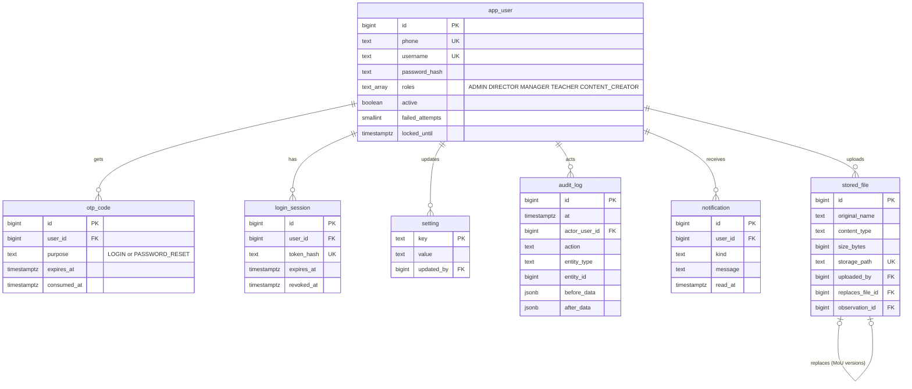

### 2.2 Master data [MVP]

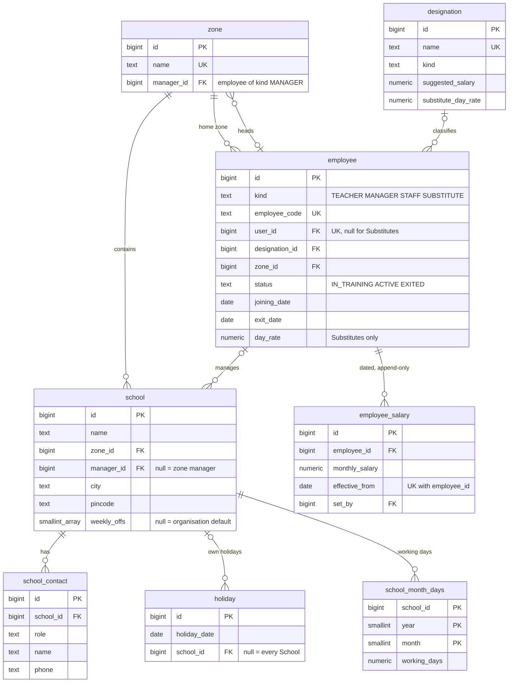

### 2.3 Contracts and placement [MVP]

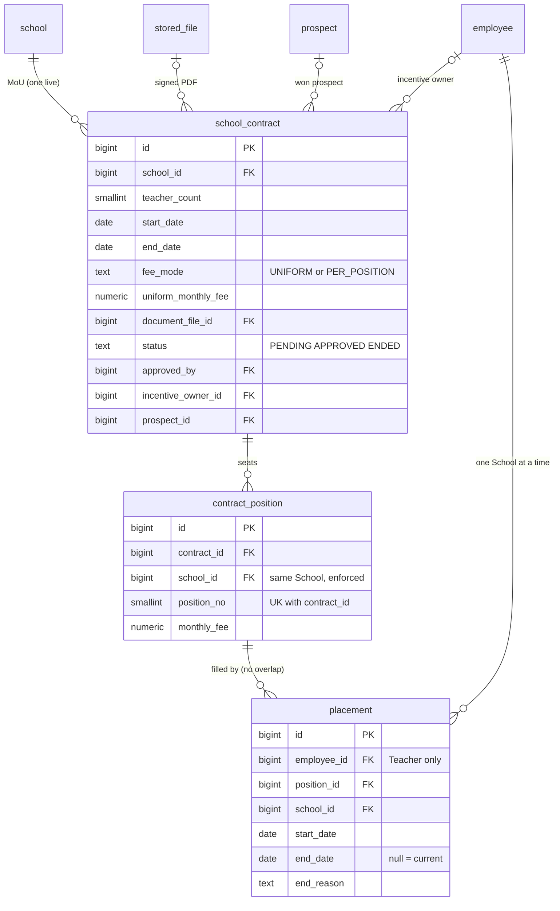

### 2.4 Attendance and leave [MVP]

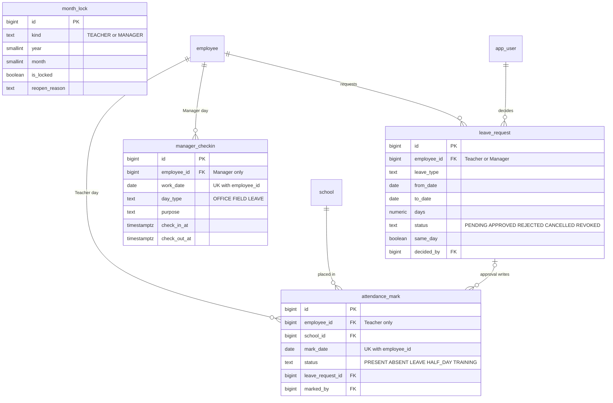

### 2.5 Substitution and payroll [MVP]

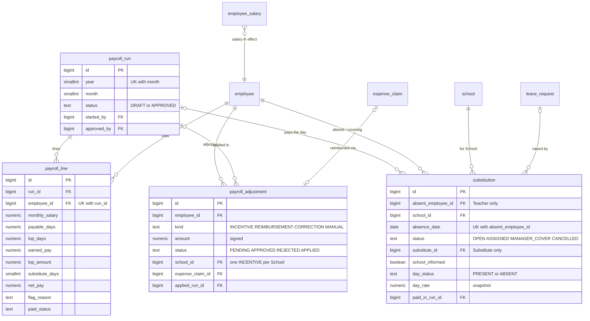

### 2.6 Billing [MVP]

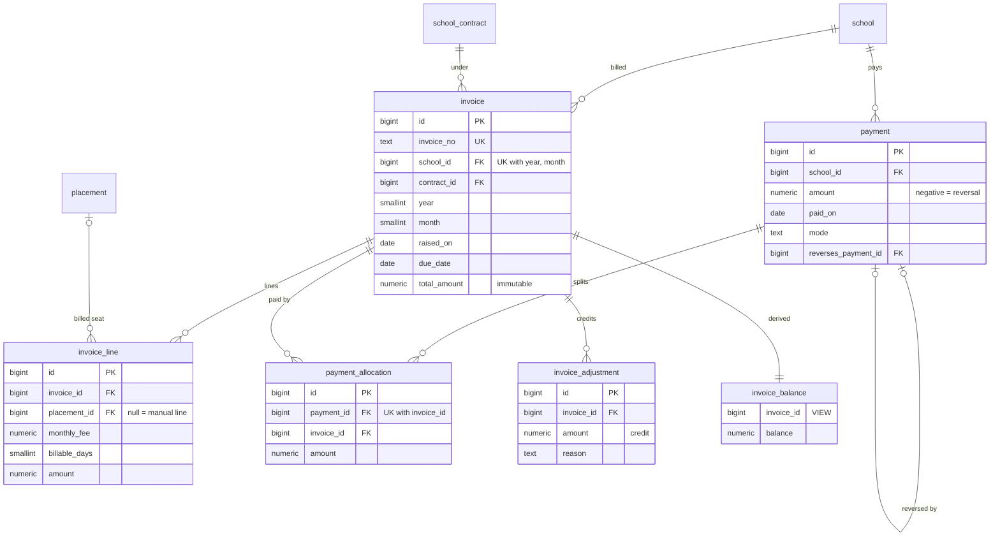

### 2.7 Expenses [MVP; budget is Phase 2]

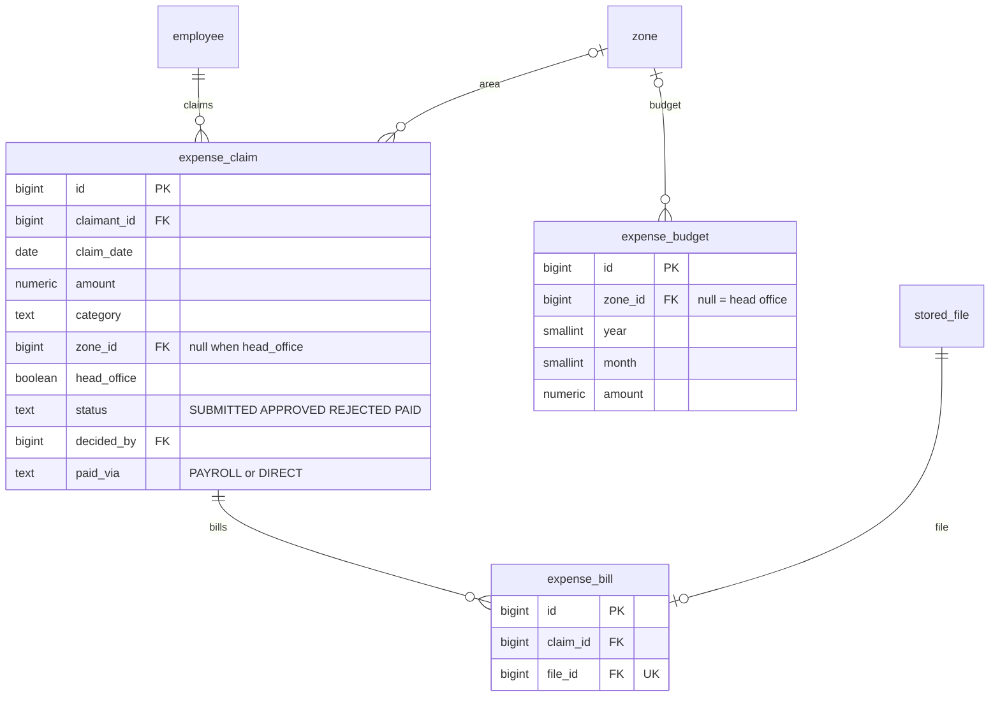

### 2.8 Recruitment and training [Phase 2]

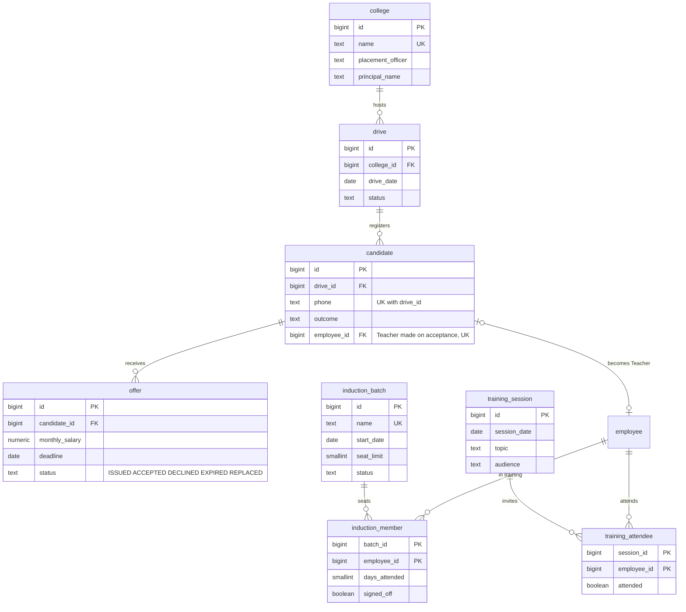

### 2.9 Marketing, tasks, performance, transfers [Phase 2]

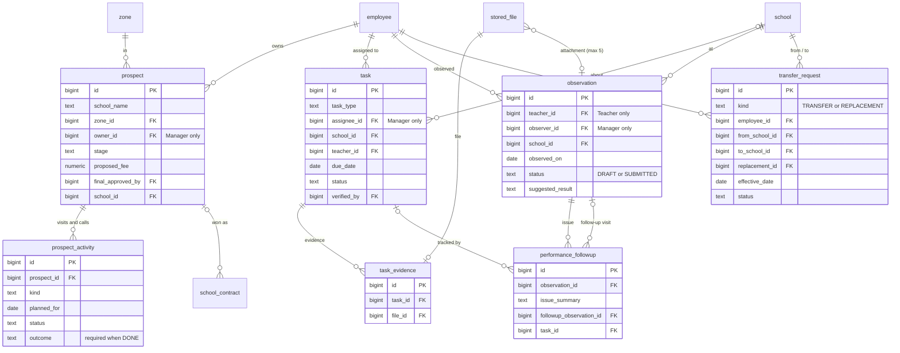

### 2.10 Content [Phase 2]

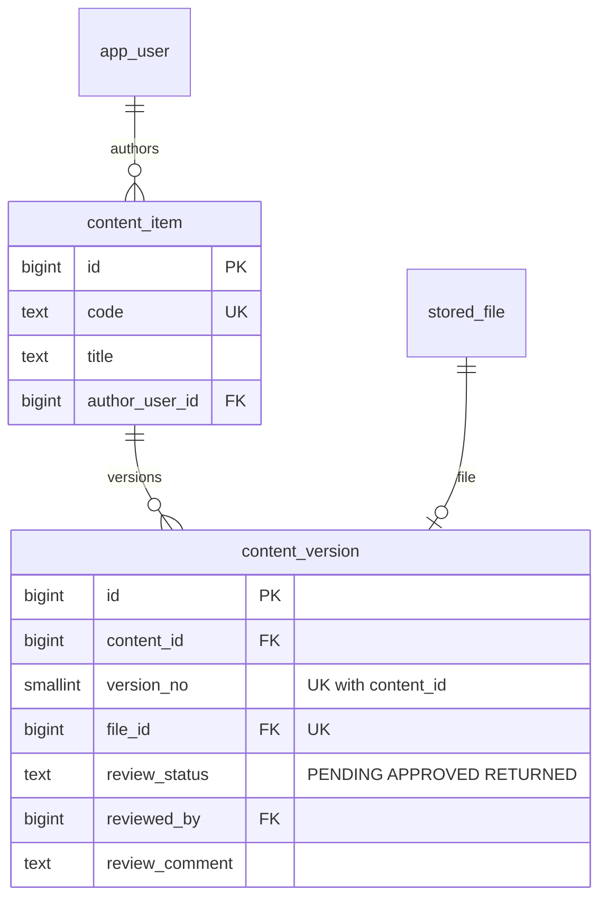

## 3. Old table to new table mapping (all 146 objects)

Source: `docs/er-diagrams.md` section 3 and the count check in its section 6 (146 objects = 145 base tables plus the view `due_balance`). Result codes: **KEPT** the concept survives as a table (often renamed or trimmed), **MERGED** folded into another table or into columns of it, **AUDIT** replaced by rows in `audit_log`, **SETTING** a row in `setting` or a code constant, **DERIVED** computed by a query, **DROPPED** not rebuilt.

### 3.1 identity (7)

| Old table | New | Result | Reason |
| --- | --- | --- | --- |
| `app_user` | `app_user` | KEPT | Roles become a `text[]` column; theme preference and `linked_teacher_id` gone (link lives in `employee.user_id`). |
| `one_time_code` | `otp_code` | KEPT | Renamed, hash only. |
| `permission_matrix` | none | DROPPED | Five fixed roles; the role x capability table is code (decision 8). |
| `renewal_credential` | `login_session` | MERGED | One session token renewed on activity; no rotating refresh-token reuse detection. |
| `role_assignment` | `app_user.roles` | MERGED | Roles are a column list. |
| `session` | `login_session` | KEPT | Renamed (the old name clashed with training sessions). |
| `user_preferences` | none | DROPPED | Themes dropped (spec 039). |

### 3.2 audit (4)

| Old table | New | Result | Reason |
| --- | --- | --- | --- |
| `api_access_entry` | none | DROPPED | Device location on every API call dropped; location only at Manager check-in/out. |
| `change_history_entry` | `audit_log` | AUDIT | The single audit table. |
| `login_history_entry` | `app_user.last_login_at`, `failed_attempts` | MERGED | Failed sign-ins go to the server log. |
| `user_activity_entry` | `audit_log` | AUDIT | Business actions only; page-view activity dropped. |

### 3.3 settings (1)

| Old table | New | Result | Reason |
| --- | --- | --- | --- |
| `system_setting` | `setting` | KEPT | Plain key-value, no range framework. |

### 3.4 school (4)

| Old table | New | Result | Reason |
| --- | --- | --- | --- |
| `place` | `school.city`, `school.pincode` | MERGED | No PIN bulk import; two text columns. |
| `school` | `school` | KEPT | Gains `manager_id` (replaces assignment table) and `weekly_offs`. |
| `school_contact` | `school_contact` | KEPT | Same. |
| `zone` | `zone` | KEPT | Gains `manager_id` (replaces assignment table). |

### 3.5 organization (4)

| Old table | New | Result | Reason |
| --- | --- | --- | --- |
| `manager` | `employee` (kind MANAGER) | MERGED | One person table. |
| `manager_designation` | `designation` | MERGED | Designation list covers all kinds. |
| `school_manager_assignment` | `school.manager_id` | MERGED | One Manager per School; history in `audit_log`. |
| `zone_manager_assignment` | `zone.manager_id` | MERGED | Same; history in `audit_log`. |

### 3.6 designation (2)

| Old table | New | Result | Reason |
| --- | --- | --- | --- |
| `designation` | `designation` | KEPT | Gains kind, suggested salary, substitute day rate. |
| `employee_id_claim` | `employee.employee_code` UK | MERGED | A unique constraint replaces the claim table. |

### 3.7 teacher (2)

| Old table | New | Result | Reason |
| --- | --- | --- | --- |
| `teacher` | `employee` (kind TEACHER) | MERGED | One person table; status IN_TRAINING / ACTIVE / EXITED. |
| `teacher_salary_history` | `employee_salary` | MERGED | One dated salary history for everyone. |

### 3.8 recruitment: campus recruitment (10 of 21)

| Old table | New | Result | Reason |
| --- | --- | --- | --- |
| `college` | `college` | KEPT | Contacts become columns. |
| `college_contact` | `college` columns | MERGED | Two contacts (placement officer, principal) as columns. |
| `campus_drive` | `drive` | KEPT | Renamed. |
| `campus_drive_date` | `drive.drive_date` | MERGED | One date per drive. |
| `campus_drive_interviewer` | `drive.interviewers` | MERGED | Free text. |
| `drive_date_change` | `audit_log` | AUDIT | Date changes are audited. |
| `candidate` | `candidate` | KEPT | Outcome is a column. |
| `candidate_outcome_history` | `audit_log` | AUDIT | Outcome history. |
| `assessment_score` | `candidate.outcome_note` | MERGED | Scores not carried; note field. |
| `job_offer` | `offer` | KEPT | Superseding chain simplified to status REPLACED. |

### 3.9 recruitment: school marketing (11 of 21)

| Old table | New | Result | Reason |
| --- | --- | --- | --- |
| `marketing_prospect` | `prospect` | KEPT | Proposal terms inline. |
| `marketing_activity` | `prospect_activity` | KEPT | Visits, calls, meetings. |
| `activity_attachment` | `stored_file` | MERGED | Attachments dropped from the simplified activity; use notes. |
| `activity_attendee` | none | DROPPED | Single owner per prospect; attendees are text in the outcome. |
| `activity_date_history` | `audit_log` | AUDIT | Reschedule history. |
| `overdue_notice` | none | DERIVED | Overdue is a query (planned date passed, status PLANNED). |
| `proposal_position` | `prospect.expected_teachers`, `proposed_fee` | MERGED | Inline proposal columns. |
| `proposal_revision` | `audit_log` | AUDIT | Edit in place; old values kept in audit. |
| `prospect_owner_history` | `audit_log` | AUDIT | Owner changes audited. |
| `prospect_stage_history` | `audit_log` | AUDIT | Stage changes audited. |
| `marketing_setting` | `setting` | SETTING | Row(s) in `setting`. |

### 3.10 training (13)

| Old table | New | Result | Reason |
| --- | --- | --- | --- |
| `induction_batch` | `induction_batch` | KEPT | Same idea. |
| `induction_enrolment` | `induction_member` | KEPT | Renamed; carries days attended and sign-off. |
| `induction_absence` | `induction_member.days_attended` | MERGED | Count instead of absence rows. |
| `training_session` | `training_session` | KEPT | Plain sessions. |
| `training_assignment` | `training_attendee` | MERGED | Invited people. |
| `training_registration` | `training_attendee` | MERGED | No seat-limited registration; invitation list only. |
| `training_attendance_entry` | `training_attendee.attended` | MERGED | Flag, plus a TRAINING `attendance_mark`. |
| `training_attendance_history` | `audit_log` | AUDIT | History. |
| `training_session_history` | `audit_log` | AUDIT | History. |
| `training_pattern` | none | DROPPED | No pattern generator; Admin copies last month. |
| `training_pattern_skip` | none | DROPPED | With the pattern. |
| `training_exception` | none | DERIVED | Non-attendance is a filter on the attendee list. |
| `training_reminder_sent` | none | DROPPED | No reminder job. |

### 3.11 attendance (17)

| Old table | New | Result | Reason |
| --- | --- | --- | --- |
| `attendance_mark` | `attendance_mark` | KEPT | Fixed status list. |
| `attendance_mark_history` | `audit_log` | AUDIT | Corrections audited. |
| `attendance_status_code` | `CHECK` on `attendance_mark.status` | MERGED | Fixed codes, no configurable list. |
| `attendance_calendar_setting` | `setting` (`weekly_offs`) | SETTING | Org-wide weekly offs. |
| `attendance_non_working_date` | `holiday` | KEPT | Renamed. |
| `attendance_teacher_month` | none | DERIVED | Month totals computed from marks. |
| `attendance_teacher_month_event` | `audit_log`, `month_lock` | MERGED | Lock/reopen. |
| `school_working_days` | `school_month_days` | KEPT | Same figure. |
| `school_working_days_history` | `audit_log` | AUDIT | History. |
| `manager_day` | `manager_checkin` | KEPT | One row per Manager per day. |
| `manager_day_activity` | none | DROPPED | Field day carries a purpose text; no planned-activity link (C1 dropped). |
| `manager_day_history` | `audit_log` | AUDIT | Corrections. |
| `manager_missed_alert` | none | DERIVED | Dashboard lists "no check-in yet today". |
| `manager_month` | none | DERIVED | Computed from check-ins. |
| `manager_month_event` | `month_lock` | MERGED | Shared lock table (kind MANAGER). |
| `manager_regularization` | `manager_checkin.edited_by`, `edit_reason` | MERGED | Admin edits the day with a reason. |
| `manager_attendance_setting` | `setting` | SETTING | Row(s). |

### 3.12 leave (3)

| Old table | New | Result | Reason |
| --- | --- | --- | --- |
| `leave_request` | `leave_request` | KEPT | Shared by Teachers and Managers. |
| `manager_leave_request` | `leave_request` | MERGED | Same table, decided by Director. |
| `leave_type` | `CHECK` on `leave_request.leave_type` | MERGED | Five fixed types. |

### 3.13 payroll (13)

| Old table | New | Result | Reason |
| --- | --- | --- | --- |
| `payroll_run` | `payroll_run` | KEPT | One per month. |
| `payroll_run_line` | `payroll_line` | KEPT | Renamed. |
| `payroll_run_line_adjustment` | `payroll_line.adjustments_total` and `payroll_adjustment.applied_run_id` | MERGED | Link kept on the adjustment. |
| `payroll_adjustment` | `payroll_adjustment` | KEPT | Absorbs incentive, reimbursement, correction. |
| `payroll_payslip` | `payroll_line` | MERGED | Printable page from the line; no stored PDF. |
| `payroll_paid_month` | `payroll_line.paid_*` | MERGED | Payment status on the line. |
| `payroll_payment_entry` | `payroll_line.paid_*` | MERGED | Date, mode, reference on the line. |
| `payroll_run_event` | `audit_log` | AUDIT | Run history. |
| `person_salary` | `employee_salary` | MERGED | One salary history. |
| `designation_salary` | `designation.suggested_salary` | MERGED | A column, no history (D12). |
| `designation_day_rate` | `designation.substitute_day_rate`, `employee.day_rate` | MERGED | Rate per person with a default. |
| `pay_policy` | none | SETTING | Pay rules are constants in one `PayRules` class. |
| `staff_employment` | `employee` (kind STAFF) | MERGED | Staff are employees. |

### 3.14 substitution (5)

| Old table | New | Result | Reason |
| --- | --- | --- | --- |
| `substitution_requirement` | `substitution` | MERGED | One row per absent Teacher per date. |
| `substitute_day` | `substitution` | MERGED | Day mark and rate snapshot as columns. |
| `substitute_day_event` | `audit_log` | AUDIT | Events. |
| `substitution_history` | `audit_log` | AUDIT | History. |
| `substitute_month_lock` | none | DROPPED | Payroll approval is the lock; `substitution.paid_in_run_id` prevents double pay. |

### 3.15 schoolbilling (15)

| Old table | New | Result | Reason |
| --- | --- | --- | --- |
| `contract` | `school_contract` | KEPT | Gains approval and document columns. |
| `contract_position` | `contract_position` | KEPT | Same. |
| `contract_assignment` | `placement` | KEPT | Dated Teacher-to-position rows, no-overlap exclusion constraints. |
| `contract_signatory` | `school_contract.signatory_*` | MERGED | One signatory as columns. |
| `mou_document` | `stored_file`, `school_contract.document_file_id` | MERGED | Versions via `replaces_file_id`. |
| `mou_approval` | `school_contract.status`, `approved_by`, `approved_on` | MERGED | Two states, not five. |
| `mou_approval_event` | `audit_log` | AUDIT | Events. |
| `monthly_due` | `invoice` | KEPT | Renamed; immutable. |
| `due_line` | `invoice_line` | KEPT | Renamed. |
| `due_adjustment` | `invoice_adjustment` | KEPT | Credit adjustments. |
| `school_collection` | `payment` | KEPT | Negative row is the reversal. |
| `collection_allocation` | `payment_allocation` | KEPT | Renamed. |
| `due_balance` (view) | `invoice_balance` (view) | KEPT | Still a view. |
| `overdue_follow_up` | none | DERIVED | Overdue list per Manager; no automatic tasks. |
| `billing_setting` | `setting` (`payment_due_days`) | SETTING | Row. |

### 3.16 expenses (5)

| Old table | New | Result | Reason |
| --- | --- | --- | --- |
| `expense_claim` | `expense_claim` | KEPT | Draft state and idempotency keys dropped. |
| `expense_bill` | `expense_bill` | KEPT | Same. |
| `expense_claim_event` | `audit_log` | AUDIT | Events. |
| `expense_area_budget` | `expense_budget` | KEPT | Phase 2. |
| `expense_budget_change` | `audit_log` | AUDIT | Budget changes. |

### 3.17 transfer (4)

| Old table | New | Result | Reason |
| --- | --- | --- | --- |
| `movement_request` | `transfer_request` | KEPT | One table; kind TRANSFER or REPLACEMENT. |
| `movement_participant` | `transfer_request.employee_id`, `replacement_id` | MERGED | Columns. |
| `movement_assignment` | `placement` | MERGED | Placement rows are the history. |
| `movement_request_history` | `audit_log` | AUDIT | History. |

### 3.18 tasks (3)

| Old table | New | Result | Reason |
| --- | --- | --- | --- |
| `task` | `task` | KEPT | No Acknowledged state. |
| `task_evidence` | `task_evidence` | KEPT | Same. |
| `task_history` | `audit_log` | AUDIT | History. |

### 3.19 incentive (4)

| Old table | New | Result | Reason |
| --- | --- | --- | --- |
| `incentive` | `payroll_adjustment` (kind INCENTIVE) | MERGED | Unique index: one per School. |
| `incentive_event` | `audit_log` | AUDIT | Events. |
| `incentive_program` | `setting` (`incentive_amount`) | SETTING | One amount. |
| `no_earner` | none | DERIVED | Query: approved contracts with no owner. |

### 3.20 performance (10)

| Old table | New | Result | Reason |
| --- | --- | --- | --- |
| `observation` | `observation` | KEPT | Principal feedback text as column. |
| `observation_rating` | `observation.rating_*` | MERGED | Six rating columns with CHECK 1..5. |
| `observation_attachment` | `stored_file.observation_id` | MERGED | Owner column on the file. |
| `observation_plan` | `task` | MERGED | Planned observation is a task. |
| `principal_feedback` | `observation.principal_feedback` | MERGED | Text column. |
| `performance_issue` | `performance_followup` | MERGED | Issue and corrective action together. |
| `corrective_action` | `performance_followup` | MERGED | Same row. |
| `issue_link` | `performance_followup.followup_observation_id`, `task_id` | MERGED | Columns. |
| `performance_history` | `audit_log` | AUDIT | History. |
| `referral` | `transfer_request` | MERGED | "Unsuitable" opens a transfer request. |

### 3.21 content (4)

| Old table | New | Result | Reason |
| --- | --- | --- | --- |
| `content` | `content_item` | KEPT | Renamed. |
| `content_version` | `content_version` | KEPT | Gains review columns. |
| `content_review` | `content_version.review_*` | MERGED | Review outcome on the version. |
| `content_history` | `audit_log` | AUDIT | History. |

### 3.22 notification, files, infrastructure (5)

| Old table | New | Result | Reason |
| --- | --- | --- | --- |
| `notification` | `notification` | KEPT | About ten events, no purge job. |
| `stored_file` | `stored_file` | KEPT | Plus `replaces_file_id` and `observation_id`. |
| `event_publication` | none | DROPPED | No event bus (rule 3). |
| `event_publication_archive` | none | DROPPED | Same. |
| `flyway_schema_history` | tool table | KEPT | Created by the migration tool, not part of the 51 (see build plan: Flyway or Liquibase). |

### 3.23 Tally

Counted by script from the tables above (all 146 old objects appear exactly once).

| Result | Count |
| --- | --- |
| KEPT (same concept survives, often renamed or trimmed; includes the view and the migration tool table) | 46 |
| MERGED into another table or into columns | 52 |
| AUDIT (history or event table replaced by `audit_log` rows) | 24 |
| DERIVED (computed by a query) | 7 |
| SETTING (row in `setting` or a code constant) | 6 |
| DROPPED with no replacement | 11 |
| Total | 146 |

Of the 46 KEPT, 44 are business tables (the other two are the view `due_balance`, which becomes `invoice_balance`, and `flyway_schema_history`, owned by the migration tool). The new schema has 51 tables: the 44 survivors plus seven that exist only as merge targets with no single predecessor (`employee`, `employee_salary`, `audit_log`, `month_lock`, `substitution`, `training_attendee`, `performance_followup`). Reduction: 146 objects to 51 tables (65 percent fewer).

## 4. Choices made in the DDL that the requirements document left open

1. **Teacher statuses.** `employee.status` is IN_TRAINING, ACTIVE, EXITED. The old specs say four stored statuses and do not list them (noted as unsure in the requirements document); Available, Assigned, Under Review, Transferred, Replaced are derived from `placement`, `transfer_request` and open `observation` rows.
2. **Substitute pay.** A PRESENT `substitution` row with `paid_in_run_id` null is picked up by the next payroll run, so a day marked after approval is paid in the following run with no correction machinery. The requirements text says "adjustment line"; this achieves the same result without a manual step.
3. **Incentive owner.** `school_contract.incentive_owner_id` (and `prospect_id`) carries who earns the incentive, so the MVP works before the Phase 2 prospect screens exist.
4. **Multiple MoU documents.** Kept through `stored_file.replaces_file_id` (a version chain) rather than a table.
5. **Observation attachments.** `stored_file.observation_id` is the one owner column on `stored_file`; a join table would have been a 52nd table.
6. **Observation rating areas.** Six area names are a proposal (classroom management, lesson delivery, student engagement, subject knowledge, communication, punctuality). The old specs say "several areas".
7. **Teacher home Zone.** Not stored; derived from the current placement's School. Managers and Substitutes use `employee.zone_id`.
8. **Audit log has no foreign key to its subject** (`entity_type`, `entity_id`) on purpose, so rows survive and any table can be audited.
